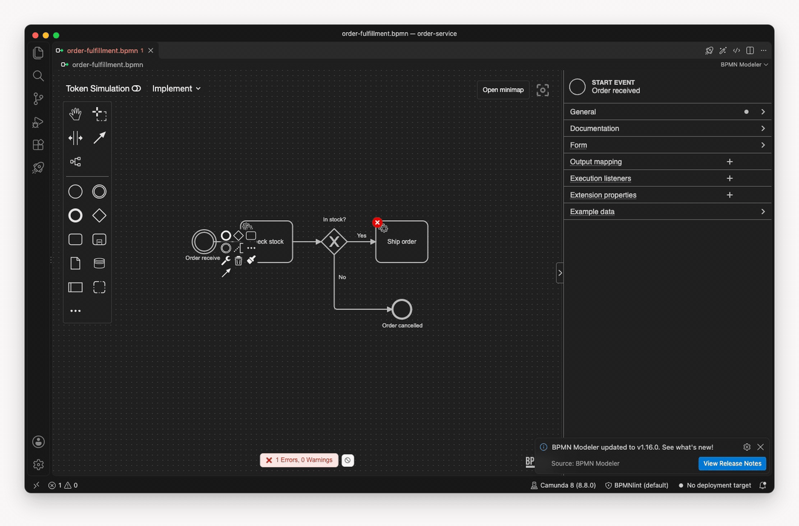
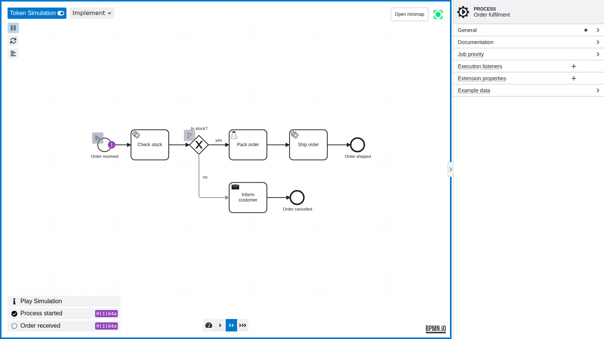

# BPMN Modeler

[![VS Marketplace][marketplace-shield]][marketplace-url]
[![Installs][installs-shield]][marketplace-url]
[![Build][build-shield]][build-url]
[![License: Apache 2.0][license-shield]][license-url]

**BPMN, where your work already happens.**

A growing family of BPMN/DMN and Camunda Form tools built around a shared modeler core — in VS Code, on the desktop, and (soon) talking to your AI assistant.

[Documentation](https://miragon.github.io/bpmn-modeler/) · [Install on Marketplace](https://marketplace.visualstudio.com/items?itemName=miragon-gmbh.vs-code-bpmn-modeler) · [Issues](https://github.com/Miragon/bpmn-modeler/issues)

---

## Why we built this

Process diagrams are code. They live in your repo, get reviewed in pull
requests, and ship with the rest of your software. But for years the only
way to edit them was a separate desktop modeler — context switch, save,
re-open in your IDE, commit, repeat.

We wanted to skip the round trip. **Open a `.bpmn` file. Model. Commit.
Done.** Same editor, same git workflow, same diff in code review.

That first idea, *bring BPMN modeling to where engineers already are*, turned
into the VS Code modeler you see above. The same modeler now runs wherever
process work happens:

## Use it where you work

- **In VS Code:** the [BPMN Modeler extension](apps/vscode-plugin/README.md) opens
  `.bpmn`, `.dmn` and `.form` files as editors, with deployment, the BPMN diff
  and jumps into your code. It is on the
  [Visual Studio Marketplace][marketplace-url] and on
  [Open VSX](https://open-vsx.org/extension/miragon-gmbh/vs-code-bpmn-modeler).
- **In IntelliJ and the other JetBrains IDEs:** the
  [Miragon BPMN Modeler plugin](apps/intellij-plugin/README.md) edits `.bpmn`
  files with the same modeler, from the
  [JetBrains Marketplace](https://plugins.jetbrains.com/plugin/32634-miragon-bpmn-modeler).
- **On the desktop:** the [desktop app](apps/standalone/README.md) for macOS,
  Windows and Linux runs the same modeler without an IDE, with source control
  and auto-save built in.
- **In [Orca](https://www.onorca.dev), experimental:** the
  [Orca plugin](apps/orca-plugin/README.md) opens `.bpmn` and `.dmn` files right
  next to the coding agent writing them, and every change the agent makes shows
  up on the canvas. It views, simulates and models lightly; it does not deploy,
  jump into code or open forms yet.

  

Different surfaces, one modeling engine, one repo.

## What you get

- **Full BPMN 2.0 + DMN modeling** for **Camunda 7** and **Camunda 8**
  (plus compatible forks like **Operaton** and **CIB7**) — engine-aware
  properties, no profile switching ceremony.
- **Camunda Form editing** — design and preview `.form` files visually, edit
  their validated JSON source, and navigate from linked Camunda 8 User Tasks.
- **Element templates by convention** — drop them in `.camunda/element-templates/`
  next to your BPMN file, the modeler picks them up. No project config required.
- **Deploy from the editor** — a sidebar that pushes your diagram to C7 or
  C8 (no auth, Basic, or OAuth2 Client Credentials) and starts a process
  instance with payload files discovered from `.camunda/payloads/`.
- **Visual BPMN diff** — open two `.bpmn` files side by side, see what
  changed at the element level (added · removed · changed · moved) with
  synchronized pan/zoom. Great in code review.
- **Speaks your language** — UI translated into 12 languages, from English
  and Deutsch to 日本語 and 한국어
  ([all languages](https://miragon.github.io/bpmn-modeler/vscode/features/language-support)).
- **Built on [bpmn.io](https://bpmn.io/)** — the toolkit the official
  Camunda Modeler is based on. You get the same modeling foundation, just
  embedded where you already work.

### Try it in 30 seconds

> Install **[BPMN Modeler][marketplace-url]** from the VS Code
> Marketplace, open any `.bpmn`, `.dmn`, or `.form` file — the modeler opens
> automatically as a custom editor. That's it.

For settings, commands, and the full feature tour see
**[`apps/vscode-plugin/README.md`](apps/vscode-plugin/README.md)** — the
same page that's published as the Marketplace listing.

## Contributing

We love pull requests, from a typo to a feature. The repository layout, the
setup, the tests and the conventions are in **[CONTRIBUTING.md](CONTRIBUTING.md)**;
each host has its own guide next to its code. Architecture decisions are recorded
in **[`docs/adr/`](docs/adr/)**.

## Support

Questions, ideas, or commercial support? Reach out at
[info@miragon.io](mailto:info@miragon.io) — or open an
[issue](https://github.com/Miragon/bpmn-modeler/issues).

## License

Distributed under the [Apache License 2.0](LICENSE).

<!-- MARKDOWN LINKS & IMAGES -->

[marketplace-shield]: https://vsmarketplacebadges.dev/version-short/miragon-gmbh.vs-code-bpmn-modeler.svg?label=VS%20Marketplace
[installs-shield]: https://vsmarketplacebadges.dev/installs-short/miragon-gmbh.vs-code-bpmn-modeler.svg?label=Installs
[build-shield]: https://github.com/Miragon/bpmn-modeler/actions/workflows/build.yml/badge.svg?branch=main
[build-url]: https://github.com/Miragon/bpmn-modeler/actions/workflows/build.yml
[license-shield]: https://img.shields.io/badge/License-Apache%202.0-blue.svg
[license-url]: https://github.com/Miragon/bpmn-modeler/blob/main/LICENSE
[marketplace-url]: https://marketplace.visualstudio.com/items?itemName=miragon-gmbh.vs-code-bpmn-modeler
