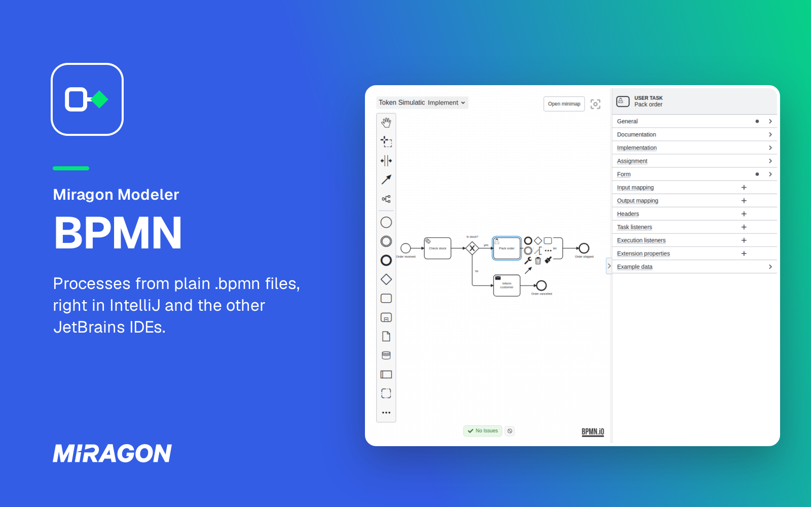
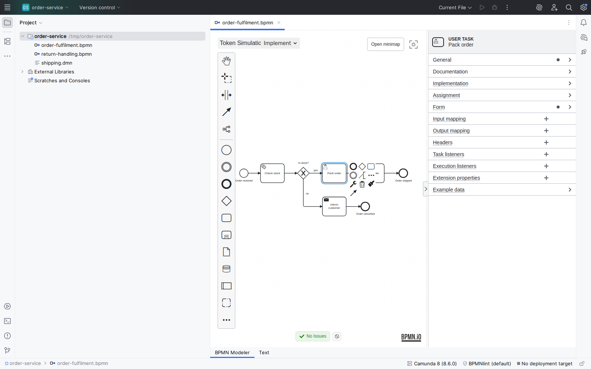
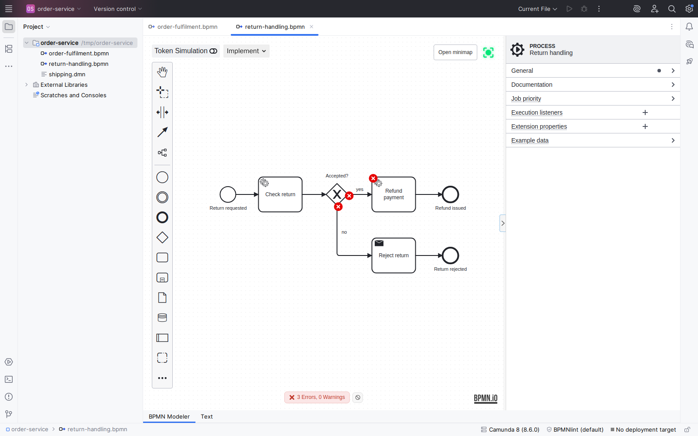

# BPMN Modeler for IntelliJ

**Model BPMN processes in IntelliJ, next to the code that runs them.**

A `.bpmn` file opens on a canvas in IntelliJ IDEA, for Camunda 7, Camunda 8, Operaton and CIB seven, and every change is saved straight back to the file. It is the same modeler as in [VS Code](../vscode-plugin/README.md), in preview: it edits BPMN, while `.dmn` files open in the IDE's own editor.

## What you get

**Camunda details in the properties panel.** The View, Design and Implement modes show as much engine detail as you need, and the properties panel sets each element's Camunda 7 or Camunda 8 attributes.

**Mistakes caught early.** Linting marks what an engine would reject, on the canvas and in the lint hint.

- **Format Diagram** in the **Tools** menu lays a diagram out.
- **Compare versions** side by side in the IDE's diff and version-control views.
- **Element templates** under `.camunda/element-templates/` show up in the modeler, and a template's JSON opens with a preview of its properties panel; the form that creates templates is in VS Code so far.
- **Scripts in the IDE:** **Generate Script Files for Script Tasks** writes each inline script to a file you edit with suggestions, synced back live.
- **Deploy to Camunda 7 or Camunda 8** from the **Deploy** tab of the **BPMN Modeler** tool window; passwords stay in the IDE's password safe.
- **Review your project's add-ons** in the **Add-ons** tab: allow or revoke bpmn-js plugins and lint rule packages, turn element templates on and off.

## Install

Needs IntelliJ IDEA Community or Ultimate 2024.2 or later or Android Studio Ladybug or later, on macOS, Linux or Windows x64. The plugin requires the IDE's Java support, so PyCharm, WebStorm and GoLand cannot install it. No Node.js needed.

1. In the IDE settings, open **Plugins** and select the **Marketplace** tab.
2. Search for **Miragon BPMN Modeler**, click **Install** and restart the IDE when asked.

Or open the [JetBrains Marketplace listing](https://plugins.jetbrains.com/plugin/32634-miragon-bpmn-modeler) and install from there.

## Get started

1. Open any `.bpmn` or `.bpmn20.xml` file. The modeler is its default editor.
2. To start from scratch, choose **New BPMN Model…** under **New** in the project view and pick **Camunda 7**, **Camunda 8** or **Engine-neutral**.
3. Select an element and set its details in the properties panel.

Every action is in **Find Action** and the **Tools** menu under **Miragon BPMN Modeler**. The [IntelliJ guide](https://miragon.github.io/bpmn-modeler/intellij/getting-started) covers the rest.

## Help and feedback

- **Documentation:** the [IntelliJ guide](https://miragon.github.io/bpmn-modeler/intellij/getting-started) and the [feature pages](https://miragon.github.io/bpmn-modeler/vscode/features/), which the plugin shares with VS Code.
- **Bugs and ideas:** [open an issue](https://github.com/Miragon/bpmn-modeler/issues). For more detail, add `io.miragon` in the IDE's **Debug Log Settings…** (under **Help**, **Diagnostic Tools**), reproduce the problem and attach the IDE log; credentials are redacted from it.

## Contributing

How to build, run and test the plugin is in [CONTRIBUTING.md](CONTRIBUTING.md).

## License

[Apache License 2.0](../../LICENSE). Made by [Miragon](https://www.miragon.io).
