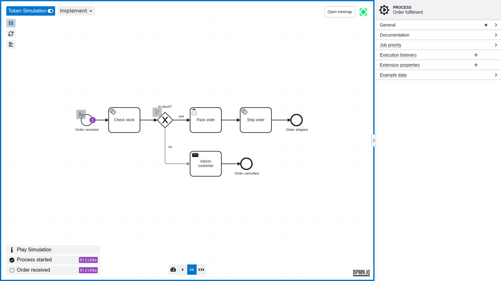
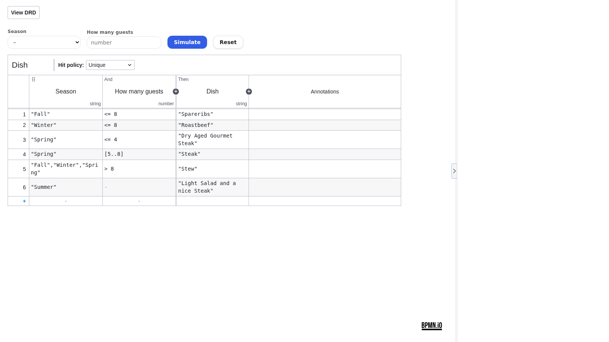

# BPMN & DMN Modeler for Orca

The [Orca](https://www.onorca.dev) plugin `bpmn-modeler`: `.bpmn` files open in the BPMN mode session (View, Design,
Implement) with the properties panel, token simulation and linting; `.dmn` files open in the DMN modeler with its
DRD, decision tables, properties panel and simulation. Orca keeps the file, its dirty state, saving and read-only
tabs; the editor owns undo. An agent's write to a clean tab shows at once; under unsaved edits Orca shows its
Reload/Overwrite banner. Users install it from the [Miragon/orca-modelers](https://github.com/Miragon/orca-modelers)
catalog; see the [Orca guide](../../docs/orca/getting-started.md).





The plugin bundles `@miragon/bpmn-modeler` and `@miragon/dmn-modeler` from source, without `modeler-core`: Orca's
editor frames are sandboxed and have no worker, network or file access, so every host capability (code links,
navigation, definition search, form preview, scripting, element templates, deployment) stays off. Why it looks the
way it does is in the [architecture ADR](../../docs/adr/architecture-and-hosts.md#host-integrations).

## Layout

| Path | Holds |
| --- | --- |
| `orca-plugin.json` | The manifest: one plugin, a custom editor per extension, `frame: "isolated"`, `engines.orca >=1.4.248` |
| `editor/<bpmn\|dmn>/index.html` | The editor pages, with an empty `#app` |
| `src/service/documentSync.ts` | Canvas ↔ Orca's document session, shared by both editors |
| `src/port/` | `DocumentSession` (Orca) and `ModelCanvas` (a modeler) |
| `src/adapter/out/` | Orca's frame API, the two canvases, the in-frame clipboard, the panel's stored state |
| `src/composition/` | The two editors' wiring and layout |
| `vite.editor.mts` | One unminified build of both editor pages into `plugin/editor/`, the code they share once in `editor/shared/`, with the eval patches Orca's `plugin check` asks for |
| `scripts/assemble-plugin.mjs` | Completes `plugin/` and fails on Orca's size limits or an `eval` call |

## Build and try it

```sh
corepack yarn workspace @miragon/bpmn-modeler-orca build   # writes apps/orca-plugin/plugin/
cd apps/orca-plugin/plugin
orca plugin validate . && orca plugin check .
orca plugin dev load . --json                              # prints the --approve fingerprint
orca plugin dev load . --json --approve <fingerprint>
```

`plugin/` is the folder Orca loads and the release publishes.

## Tests

```sh
corepack yarn workspace @miragon/bpmn-modeler-orca test              # unit specs, with the coverage gate
corepack yarn workspace @miragon/bpmn-modeler-orca test:e2e          # build, then both editors in Chromium under Orca's frame CSP
corepack yarn workspace @miragon/bpmn-modeler-orca test:orca:docker  # both editors in a real Orca, in a Linux container
```

The e2e suite runs the built editors with the Orca stub of `@miragon/modeler-shell`. The smoke test drives a real
Orca (default 1.4.250, `ORCA_VERSION=<version>` for another) with the shell's `runOrcaSmoke`: load with approval,
`plugin check`, both themes, undo, a saved delete, an agent's write and the plugin's logs. `test:orca` itself refuses
to open Orca's window on a Mac. The click points both use are in `test/fixtures/smokePoints.ts`; the e2e suite checks
that they hit their elements.

## Release

The release-please component `orca` (tag `orca-v<version>`) bumps `package.json` and `orca-plugin.json`;
`publish-orca-plugin.yml` builds, smoke-tests and publishes the folder into Miragon/orca-modelers.
