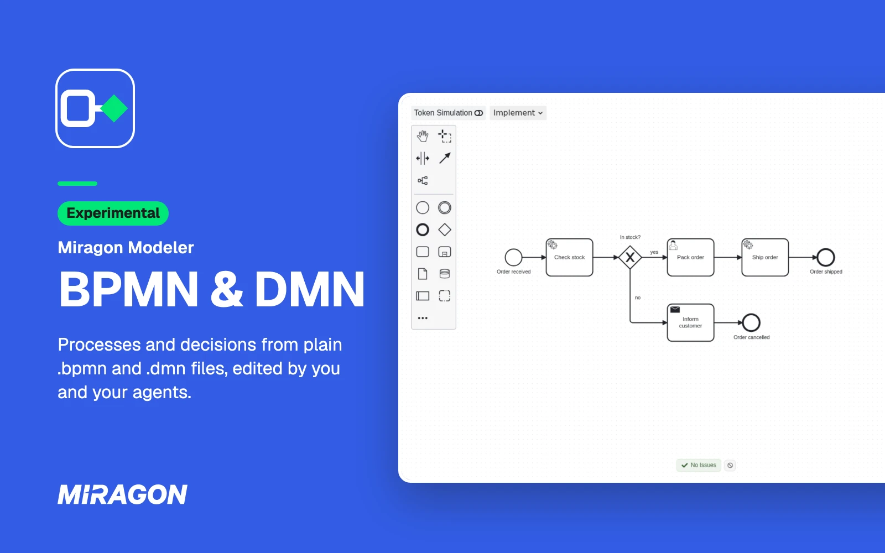
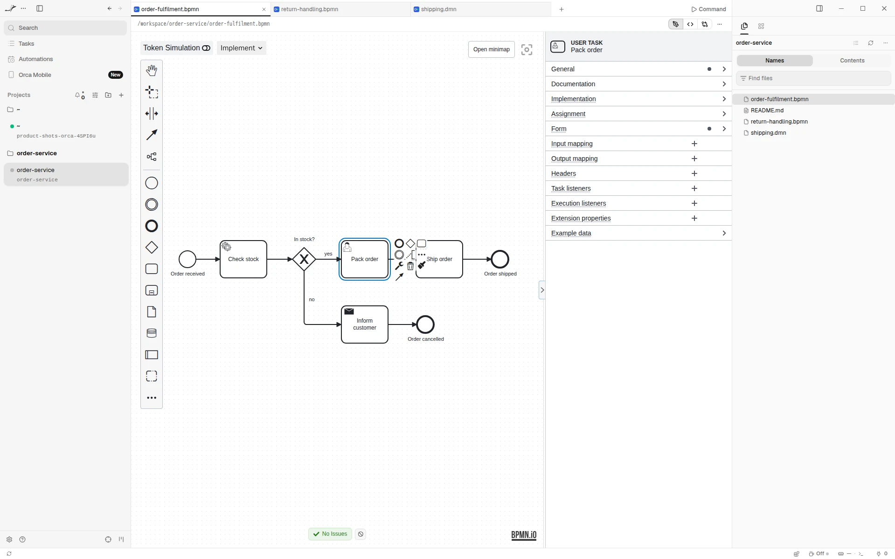
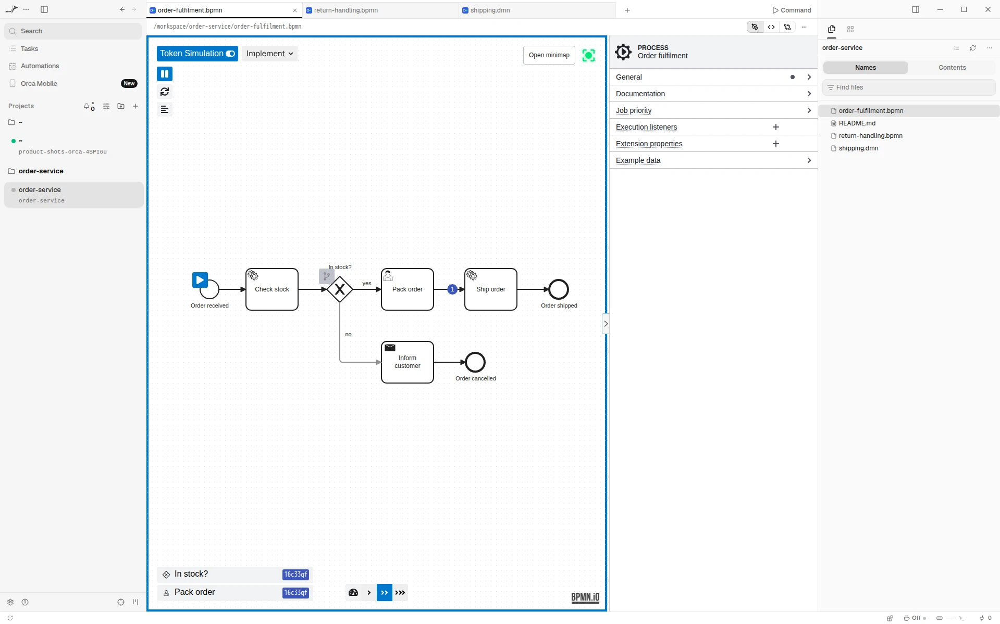
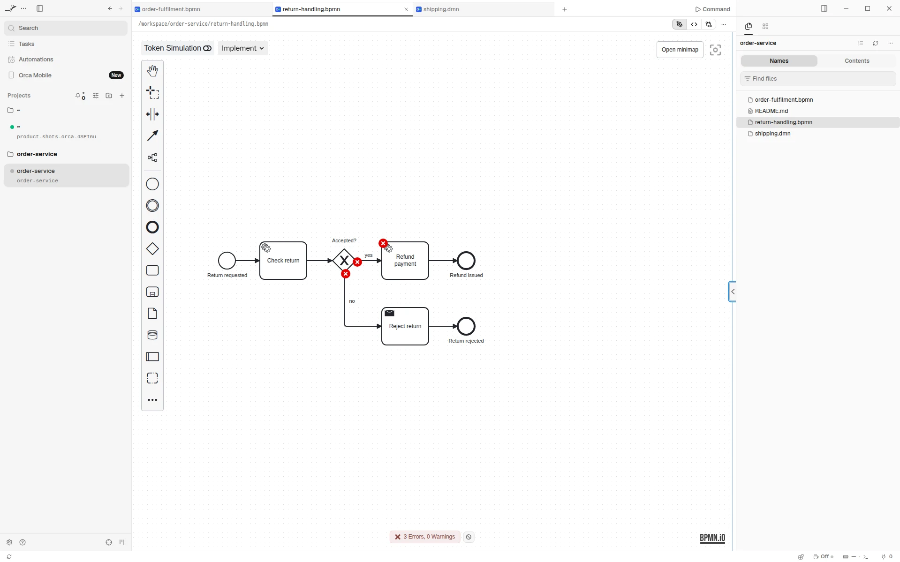
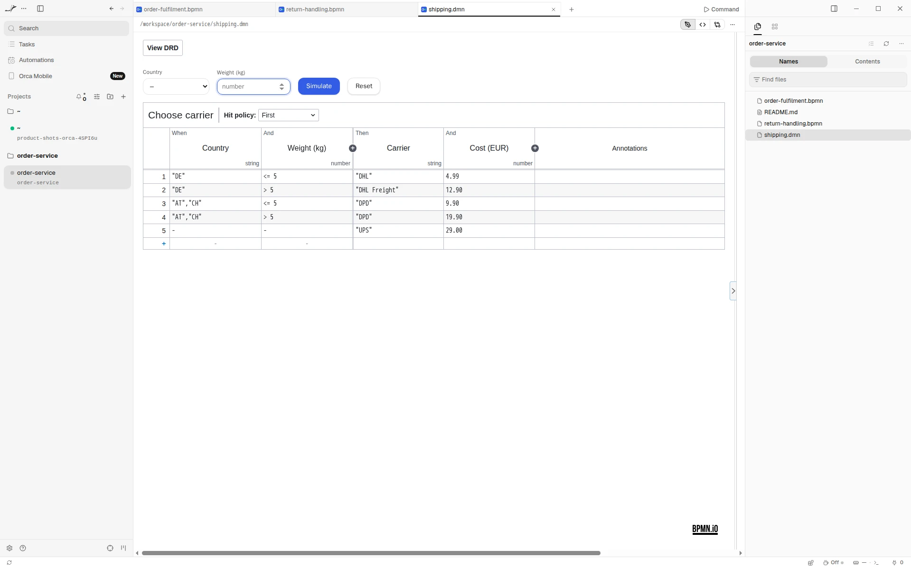

# BPMN & DMN for Orca

See the BPMN processes and DMN decisions your agent writes, and edit them right next to it. In
[Orca](https://www.onorca.dev), a `.bpmn` or `.dmn` file opens as a diagram instead of XML. The file
stays plain text, so your agent reads and writes it like code, and every change it makes shows up on
the canvas.

> **Experimental.** The plugin views, simulates and lightly models. It does not deploy, jump into
> code or open forms yet, and it may change between releases. See [Good to know](#good-to-know)
> before you rely on it.

Free and open source (Apache 2.0). No account, no network access, and it sees only the file you
open.

**[Open in Orca](https://onorca.dev/plugins/miragon.bpmn-modeler?catalog=https://github.com/miragon/orca-modelers.git)**

## Get started

1. Turn on plugins in Orca once: Settings → Plugins → **Turn on plugins**.
2. Open the plugin's page with the link above and press **Install**. The first time, Orca asks
   whether to add the [Miragon modelers catalog](https://github.com/Miragon/orca-modelers). New
   releases reach you through it.
3. Click **Try it** to open an example process, or open any `.bpmn` or `.dmn` file. **+** in the tab
   bar starts a new process or decision from an example too.

## Live while your agent writes

Each change your agent makes to the file shows up on the canvas right away. If it writes while you
have unsaved edits, Orca asks whether to reload the file or keep yours.

## Model processes

`.bpmn` files open in the View, Design and Implement modes, for Camunda 7 and Camunda 8, with the
properties panel. Run the token simulation to watch a process step by step, and let linting point
at what an engine would reject.

## Model decisions

`.dmn` files open with the decision requirements diagram, decision tables, literal and boxed
expressions, the properties panel and the decision simulation.

## Good to know

- Needs the Orca desktop app, version 1.4.248 or later.
- The plugin runs in Orca's sandbox, without file or network access. So it leaves out everything that
  needs the rest of your workspace: jumping to the code or the models a task refers to, workspace
  element templates, form previews, inline script editing, deployment, the BPMN diff and the Form
  editor. Copy and paste work within one editor tab only.
- A read-only tab, such as an agent transcript or a remote file, opens in View mode (BPMN) or locked
  (DMN).
- Light and dark follow Orca's theme, and the language follows Orca's.
- Need the rest? The [VS Code extension](../vscode-plugin/README.md),
  [IntelliJ plugin](../intellij-plugin/README.md) and [desktop app](../standalone/README.md) have it.

## Links

[Guide](https://miragon.github.io/bpmn-modeler/orca/getting-started) ·
[Report an issue](https://github.com/Miragon/bpmn-modeler/issues) ·
[Source and contributing](CONTRIBUTING.md) ·
[All Miragon modelers for Orca](https://github.com/Miragon/orca-modelers)

Made by [Miragon](https://www.miragon.io). Apache 2.0 licence.
