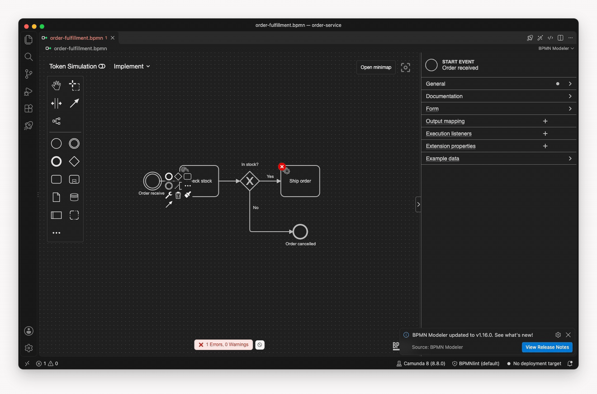

# BPMN Modeler for the desktop

[](https://github.com/Miragon/bpmn-modeler/blob/main/LICENSE)

Model BPMN processes, DMN decisions and Camunda Forms in a desktop app for macOS, Windows and Linux,
when you do not want to run an IDE. It is the same modeler as in
[VS Code](../vscode-plugin/README.md), in an [Eclipse Theia](https://theia-ide.org/) window, with
source control and auto-save built in.



Free and open source (Apache 2.0). No account.

**[Download](https://miragon.github.io/bpmn-modeler/download)**

## Get started

1. Get the package for your system from the
   [Download page](https://miragon.github.io/bpmn-modeler/download): a signed `.dmg` for macOS, an
   `.exe` installer for Windows, or the Flatpak for Linux. On macOS, Homebrew works too:

   ```bash
   brew install --cask miragon/tap/miragon-bpmn-modeler
   ```

2. Open a `.bpmn`, `.dmn` or `.form` file with **File ▸ Open…**, or drop it onto the window. **File ▸
   Open Folder…** opens a folder of models.

## What you get

Everything the VS Code extension does: the View, Design and Implement modes, the properties panel
for Camunda 7 and Camunda 8, linting, token simulation, element templates, DMN and Camunda Forms,
and deployment to Camunda. On top of that:

- **Source control** with Git, including the BPMN diff that shows what changed at the element
  level.
- **Auto-save** one second after your last edit.

## Good to know

- The macOS and Windows apps update themselves; the Flatpak updates with `flatpak update`.
- Source control needs `git` on macOS and Windows; the Flatpak brings its own.
- There is no Extensions view.

## Links

[Guide](https://miragon.github.io/bpmn-modeler/standalone/getting-started) ·
[Features](https://miragon.github.io/bpmn-modeler/vscode/features/) ·
[Releases](https://github.com/Miragon/bpmn-modeler/releases) ·
[Report an issue](https://github.com/Miragon/bpmn-modeler/issues) ·
[Source and contributing](CONTRIBUTING.md)

Made by [Miragon](https://www.miragon.io). Apache 2.0 licence.
