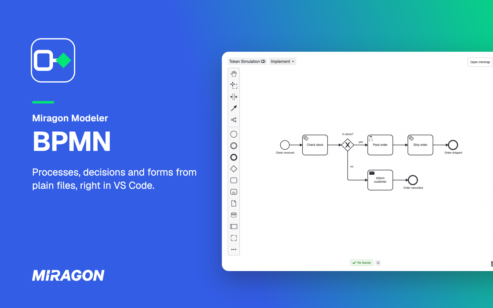
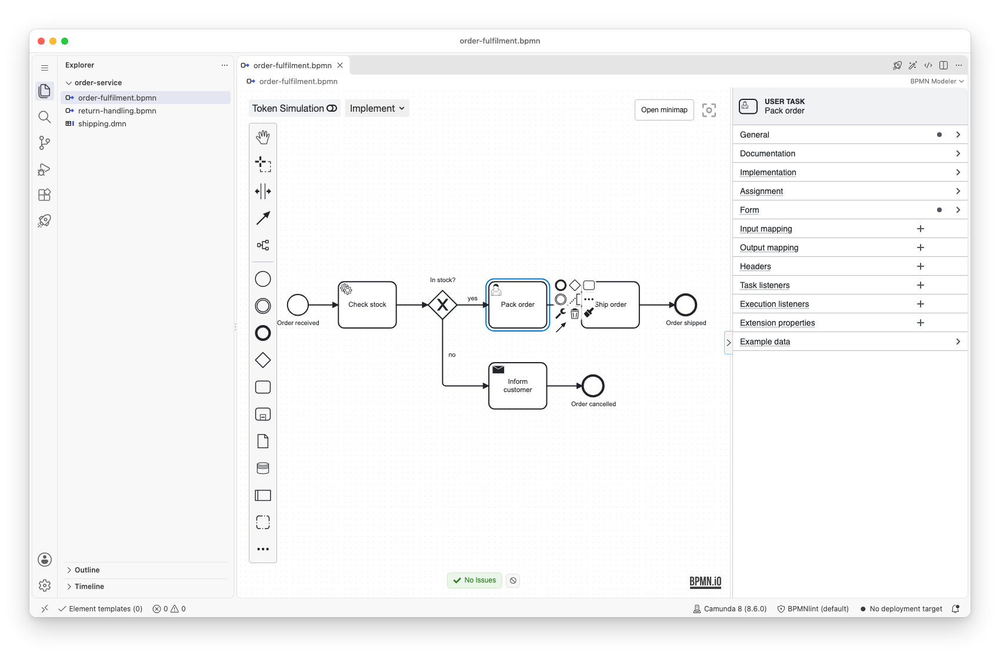
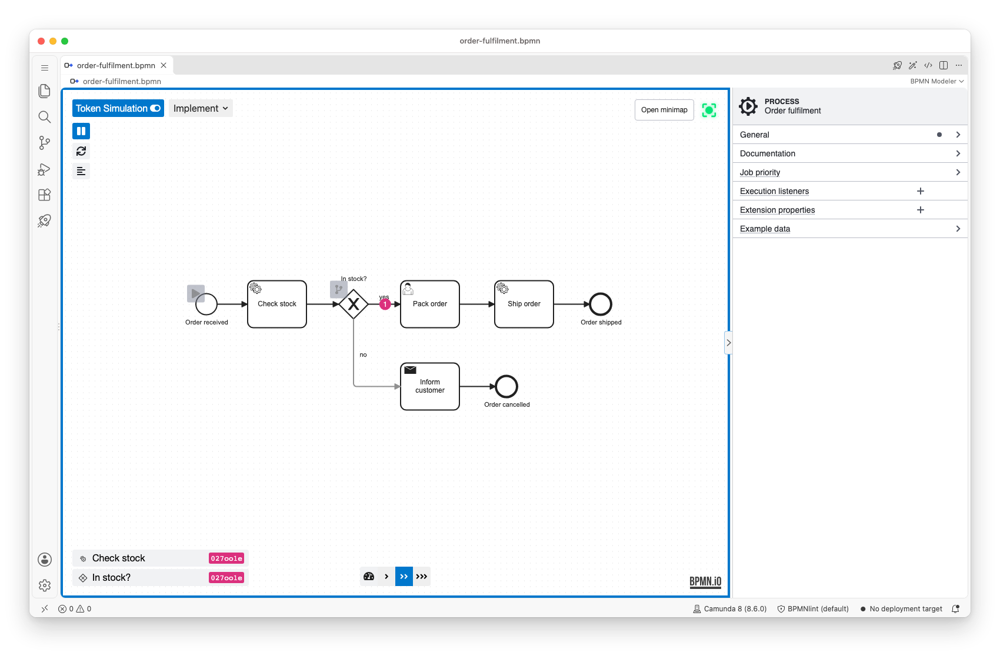
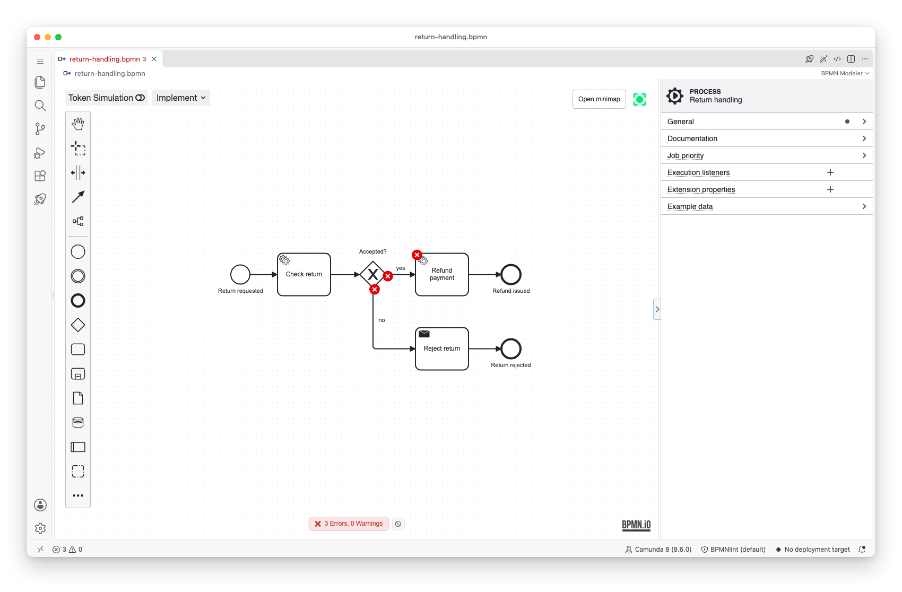
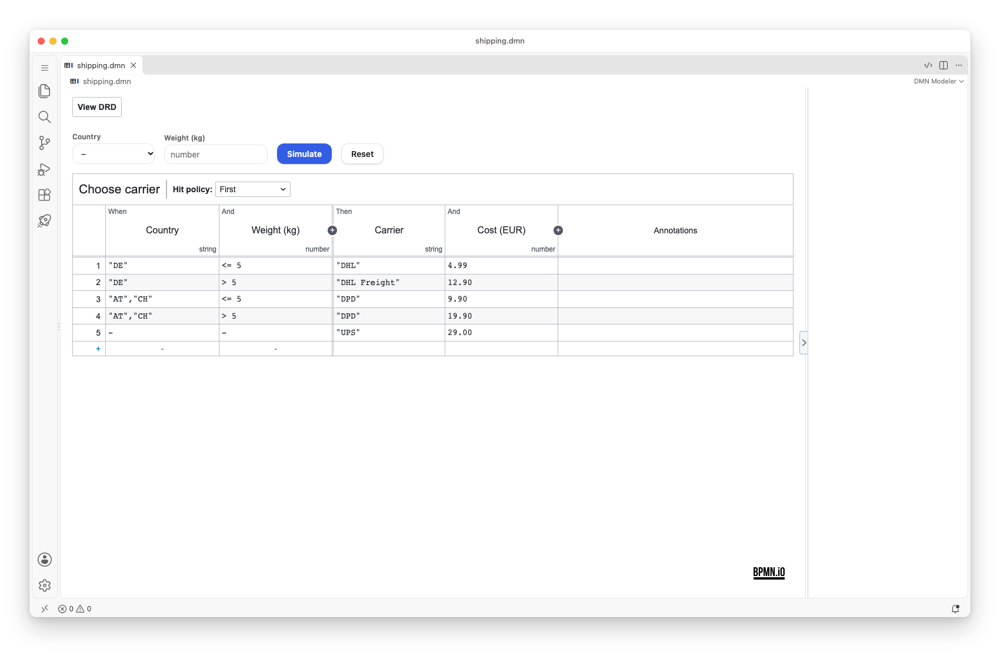
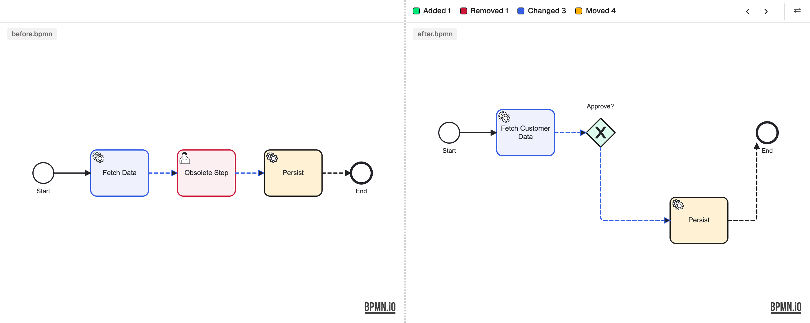

# BPMN Modeler for VS Code

**Model processes, decisions and forms in VS Code, next to the code that runs them.**

A `.bpmn`, `.dmn` or `.form` file opens in a graphical editor for Camunda 7, Camunda 8, Operaton and CIB seven, and the file stays the source of truth: save, Git and diff work as for your code. Free and open source, built on [bpmn.io](https://bpmn.io), no account.

## What you get

**Camunda details in the properties panel.** Add elements from the palette or the context pad and set their Camunda 7 or Camunda 8 details. The View, Design and Implement modes show as much engine detail as you need.

**Play it through.** The token simulation runs a process step by step, so you see each path before you deploy it.

**Mistakes caught early.** Linting marks what the engine would reject, on the canvas and in the **Problems** view, with your workspace's `.bpmnlintrc` when there is one.

**Decisions and forms.** Edit DMN decision tables and try them with the simulation above the table. Camunda Forms open in a visual editor with a preview.

**Compare and deploy.** Select two `.bpmn` files in the Explorer and choose **Compare Selected (BPMN)** to see what changed element by element, and the **Deploy** view deploys to Camunda 7 or Camunda 8 and starts an instance.

Element templates under `.camunda/element-templates/` show up without any project setup. The modeler speaks 12 languages. The [feature overview](https://miragon.github.io/bpmn-modeler/vscode/features/) lists everything.

## Install

Needs VS Code 1.76 or later.

- **VS Code Marketplace:** [BPMN Modeler](https://marketplace.visualstudio.com/items?itemName=miragon-gmbh.vs-code-bpmn-modeler), or `code --install-extension miragon-gmbh.vs-code-bpmn-modeler`.
- **Open VSX**, for VSCodium, Cursor, Windsurf and other editors that use it: [BPMN Modeler](https://open-vsx.org/extension/miragon-gmbh/vs-code-bpmn-modeler).

## Get started

1. Open any `.bpmn`, `.dmn` or `.form` file, or run **New BPMN Model**, **New DMN Model** or **New Form** from the Command Palette. It opens in the modeler.
2. Select an element and set its details in the properties panel.
3. New to BPMN? The walkthrough **Get Started with BPMN Modeler** (**Help: Get Started**) shows how to create, edit and deploy a diagram.

Every command starts with **Miragon BPMN Modeler:**, and the [configuration page](https://miragon.github.io/bpmn-modeler/vscode/configuration) lists every setting.

## Help and feedback

- **Documentation:** every feature, setting and limit is explained at [miragon.github.io/bpmn-modeler](https://miragon.github.io/bpmn-modeler/).
- **Bugs and ideas:** [open an issue](https://github.com/Miragon/bpmn-modeler/issues). Set the log level of the **bpmn.modeler** output channel to **Debug** (**Developer: Set Log Level…**), reproduce the problem and paste the channel; credentials are never logged.
- **Changes:** see the [changelog](https://github.com/Miragon/bpmn-modeler/blob/main/apps/vscode-plugin/CHANGELOG.md).
- **Other editors:** the same modeler runs in [IntelliJ](https://plugins.jetbrains.com/plugin/32634-miragon-bpmn-modeler), as a [desktop app](https://miragon.github.io/bpmn-modeler/download) and, experimental, in [Orca](https://miragon.github.io/bpmn-modeler/orca/getting-started).

## Contributing

How to build, test and change the extension is in [CONTRIBUTING.md](https://github.com/Miragon/bpmn-modeler/blob/main/CONTRIBUTING.md).

## License

[Apache License 2.0](https://github.com/Miragon/bpmn-modeler/blob/main/LICENSE). Made by [Miragon](https://www.miragon.io).
