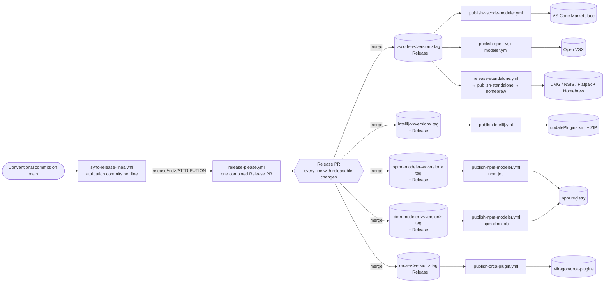

# Release process

This page documents the release workflow for maintainers. The user-facing
version history lives on
[GitHub Releases](https://github.com/Miragon/bpmn-modeler/releases).

## Overview

The repo ships on **five independent release lines**, so a change to one host
does not force a release of the others:

| Line | Tag | Covers | Publishes to |
|---|---|---|---|
| **`bpmn-modeler`** | `bpmn-modeler-v<version>` | The publishable `@miragon/bpmn-modeler` package + the libs it inlines | npm registry |
| **`vscode`** | `vscode-v<version>` | VS Code extension + Open VSX + Standalone desktop app | VS Code Marketplace, Open VSX, GitHub Release (DMG/NSIS/Flatpak) + Homebrew |
| **`intellij`** | `intellij-v<version>` | IntelliJ plugin | JetBrains Marketplace + `updatePlugins.xml` |
| **`orca`** | `orca-v<version>` | The Orca plugin with the BPMN and DMN editors | [Miragon/orca-plugins](https://github.com/Miragon/orca-plugins) and its catalog |
| **`dmn-modeler`** | `dmn-modeler-v<version>` | The publishable `@miragon/dmn-modeler` package + the libs it inlines | npm registry |

VS Code, Open VSX and Standalone stay on **one** shared version because they are
all built from the same frontend (`libs/shared`, the webviews). IntelliJ is a
separate Gradle plugin and versions on its own. The private root `package.json`
follows the `@miragon/bpmn-modeler` version.

The flow has two phases, both automated:

1. **Prepare** — [release-please](https://github.com/googleapis/release-please)
   watches `main` and maintains **one combined Release PR**
   (`separate-pull-requests: false`) covering every line with releasable
   changes. For each included line it bumps the version files and updates that
   line's `CHANGELOG.md`; when merged it cuts each included line's tag + GitHub
   Release. A line without releasable changes is simply left out.
2. **Publish** — merging the Release PR triggers `release-please.yml`, which
   waits for one approval and then fans out to the publish jobs of every
   released line. The lines have **no release order**: each builds from source
   at its own tag. Each `publish-*` workflow is also runnable on its own via
   `workflow_dispatch` for reruns.

A single line cannot be held back: merging the Release PR ships every line it
contains (see
[Release and publishing: release pull request](https://github.com/Miragon/bpmn-modeler/blob/main/docs/adr/release-and-publishing.md#release-pull-request)).

### How commits are routed

**No release line watches source code.** Each line is a release-please package
at `release/<id>/` (`version.txt`, `ATTRIBUTION`), and release-please releases
it from the commits that change that folder. Only
[`sync-release-lines.yml`](https://github.com/Miragon/bpmn-modeler/blob/main/.github/workflows/sync-release-lines.yml)
commits there. The decision is in
[`release-routing.mjs`](https://github.com/Miragon/bpmn-modeler/blob/main/.github/scripts/release-routing.mjs),
reading the registry
[`.github/release-lines.json`](https://github.com/Miragon/bpmn-modeler/blob/main/.github/release-lines.json)
(see
[Release and publishing: release lines and attribution](https://github.com/Miragon/bpmn-modeler/blob/main/docs/adr/release-and-publishing.md#release-lines-and-attribution)):

- `ships` lists the paths a line delivers to its users: its own folder and every
  workspace its build bundles. `releaseLines.spec.ts` fails when it drifts from
  the builds.
- `ignore` lists files no user receives, inside shipped folders too: specs,
  tests, fixtures, READMEs, changelogs.
- `unreleased` lists the workspaces no line ships (`tools/*`, `docs`).

For a `feat` or `fix`, the lines are those that ship one of its changed files
that is not ignored. `chore`, `docs` and `refactor` reach no line, and neither
does a change to only top-level files (`yarn.lock`, `package.json`, `AGENTS.md`),
`.github`, docs or tests. Until #2548 adds a declaration in the PR, the lines come
from the files alone, so a change to a shared library reaches every line that
bundles it, whether or not that line offers the feature.

### Attribution commits

On every push to `main`, the sync workflow takes each first-parent commit of the
push. It skips its own commits and release-please's release commits, routes the
rest and writes **one attribution commit per line group**, all in one
fast-forward of `main`. An attribution commit changes `release/<id>/ATTRIBUTION`
of each line in its group, and its subject is the routed commit's subject plus
the short sha, for example
`fix(bpmn-webview): fetch a surface in at most ten files at once (#2538) [sync 5bc86fa]`.
That puts the real change under its real title into each line's changelog.

- **A breaking `!` stays only where it breaks.** `bpmn-modeler` keeps it for any
  file it ships, since its contract spans its inlined libraries. A host or the
  DMN package keeps it only when the change touches its own folder
  (`apps/vscode-plugin`, `apps/intellij-plugin`, `apps/orca-plugin`,
  `packages/dmn-modeler`). The other lines get the same subject without the `!`,
  in a commit of their own.
- **Nothing is written twice.** Before writing, the sync reads the existing
  `[sync <short sha>]` commits of each line and skips a line that has one, so a
  re-run is safe.
- **Races retry.** When `main` moves between the read and the ref update, the run
  re-reads `main` and tries again, up to five times. The workflow has no
  concurrency group, because GitHub would cancel all but one pending run of a
  group and drop those pushes.
- The step summary of each run lists every commit with its decision.

### The release PR check and reconcile

[`release-attribution.yml`](https://github.com/Miragon/bpmn-modeler/blob/main/.github/workflows/release-attribution.yml)
runs on every PR to `main` and passes at once, except on the release PR
(`release-please--branches--main`). There it runs `release-routing.mjs audit` and
fails when a `feat`/`fix` since a line's last tag lacks its attribution, which
happens when a sync run failed or was skipped. The log names each gap and the
command that fills it:

```bash
gh workflow run sync-release-lines.yml --repo Miragon/bpmn-modeler --ref main -f reconcile=true
```

A `reconcile` dispatch walks every first-parent commit since each line's last tag
and adds only the attributions that are missing. Dispatched with `reconcile`
unchecked, it lists them in the step summary and writes nothing. To see the same
locally (read-only, needs `gh auth`):

```bash
node .github/scripts/release-routing.mjs reconcile --dry-run --repo Miragon/bpmn-modeler
```

### Correcting a pending release PR

release-please regenerates the Release PR on every push to `main`, and a reverted
attribution commit still counts, so fix a wrong release in this order:

- **A change is missing on a line**: run `reconcile` as above.
- **A line lists a change it does not ship**: fix the registry so the next change
  routes right. For the pending release, pause merges to `main`, then edit that
  line's section in the Release PR body and its `CHANGELOG.md` on the release
  branch right before merging. The GitHub Release notes come from the merged PR
  body.
- **A line needs a different version**: set `release-as` on its package in
  `release-please-config.json` in a PR, and remove it after the release.

## Pipeline flow



## Configuration

release-please is driven by two checked-in files, which `releasePackages.spec.ts`
holds to the registry:

- **`release-please-config.json`** — five packages, one per line, at
  `release/<id>`, `separate-pull-requests: false` (one combined Release PR). Each
  is `release-type: simple` with `component: <id>` and
  `include-component-in-tag: true` → tag `<id>-v<version>`. The `simple` strategy
  bumps `release/<id>/version.txt`. Paths with a leading `/` are read from the
  repository root:
  - `changelog-path` keeps each changelog where it was:
    `/packages/bpmn-modeler/CHANGELOG.md`, `/apps/vscode-plugin/CHANGELOG.md`,
    `/apps/intellij-plugin/CHANGELOG.md`, `/apps/orca-plugin/CHANGELOG.md`,
    `/packages/dmn-modeler/CHANGELOG.md`.
  - `extra-files` stamp every file that carries the version: the package's
    `package.json` (and the root `package.json` for `bpmn-modeler`), for
    `vscode` also `apps/standalone/package.json` and
    `libs/standalone-extension/package.json` (lockstep), for `orca` also
    `orca-plugin.json`, and for `intellij` `gradle.properties` (`pluginVersion`)
    through the `generic` updater, anchored by the
    `# x-release-please-start-version` markers.
  - `changelog-sections` map commit **types** (`feat`/`fix`/`refactor`/`docs`/
    `chore`) to changelog headings.
- **`.release-please-manifest.json`** — `{ "release/bpmn-modeler": "…",
  "release/vscode": "…", … }`, the current version of each line. release-please
  updates it on each release.

## Releasing

### 1. Cut the release (prepare)

1. Merge your feature/fix PRs into `main` with Conventional-Commit titles. The
   changed files decide which lines a `feat`/`fix` lands on (see "How commits are
   routed" above); the sync workflow writes the attribution commits.
2. release-please opens/updates **one Release PR** (`chore: release main`)
   with a section per affected line. Review the versions + changelogs, and check
   that `Release attribution` is green (see "The release PR check and
   reconcile").
3. **Merge the Release PR.** It pushes the version bumps, tags every included
   line (e.g. `vscode-v<version>`, `intellij-v<version>`), and creates their
   GitHub Releases — which triggers their publish jobs after one approval.

### 2. Publishing (automatic, per line)

Merging the Release PR fans out via `release-please.yml` to every released line:

| Line | Auto-publishes | Notes |
|---|---|---|
| `vscode` | `publish-vscode-modeler.yml`, `publish-open-vsx-modeler.yml`, `release-standalone.yml` | Marketplace + Open VSX (both Trusted Publishing, OIDC) + DMG/NSIS/Flatpak + Homebrew. |
| `intellij` | `publish-intellij.yml` | Multi-platform ZIP → JetBrains Marketplace, refreshes `docs/public/updatePlugins.xml`. |
| `bpmn-modeler` | `publish-npm-modeler.yml` (`npm` job) | Builds + packs + smoke-tests, then `npm publish --provenance` to the npm registry via Trusted Publishing (OIDC). |
| `dmn-modeler` | `publish-npm-modeler.yml` (`npm-dmn` job) | Same workflow, parameterised for `@miragon/dmn-modeler` (`workspace`/`package-dir`/`smoke-extra-deps: jsdom esbuild` inputs); publishes to npm via Trusted Publishing. |
| `orca` | `publish-orca-plugin.yml` | Builds and smoke-tests the plugin folder, then hands it to Miragon/orca-plugins. |

Each `publish-*` workflow is also runnable on its own via `workflow_dispatch`
(pass the line's tag, e.g. `tag: vscode-v1.4.0` / `tag: intellij-v1.4.0`) with a
`dry-run` option for reruns.

> **`publish-open-vsx-modeler.yml` dispatch is dry-run-only** for the same
> reason as npm below: its trusted publisher is registered for
> `release-please.yml`. Re-run a failed real publish through the `open-vsx` job
> of the release run.

> **`publish-npm-modeler.yml` dispatch is dry-run-only.** The one workflow
> serves both npm packages — dispatch it with the `workspace` /`package-dir` /
> `smoke-extra-deps` inputs (defaults target `@miragon/bpmn-modeler`; pass
> `@miragon/dmn-modeler` + `packages/dmn-modeler` + `jsdom esbuild` for the DMN
> package — the DMN smoke bundles its consumer, since the dmn-js stack only
> resolves through a bundler). npm Trusted Publishing validates the **top-level caller** workflow
> filename, and the trusted publisher is configured for `release-please.yml`. A
> manual `workflow_dispatch` of the npm workflow therefore always runs as a
> dry-run (build + pack + smoke + `npm publish --dry-run`), even if you set
> `dry-run: false`. To re-run a failed **real** publish, re-run the `npm` (or
> `npm-dmn`) job on the triggering `release-please.yml` run — not the standalone
> workflow. The publish step is idempotent: it skips if the version is already
> on npm.

> The `@miragon/create-append-c7` polyfill that the BPMN webview depends on
> lives in its [own repository](https://github.com/Miragon/create-append-c7)
> and is consumed here as a published npm dependency — its release is cut
> there, not in this repo.

## Per-host "what's live" overview

Each publish workflow records a GitHub **deployment** on success, to a per-host
environment:

| Host | Environment |
|---|---|
| VS Code | `vscode-marketplace` |
| Open VSX | `open-vsx-marketplace` |
| IntelliJ | `jetbrains-marketplace` |
| Standalone | `standalone` |
| npm package (`@miragon/bpmn-modeler`) | `npm-bpmn-modeler` |
| DMN npm package (`@miragon/dmn-modeler`) | `npm-dmn-modeler` |

The repo
[Environments / Deployments page](https://github.com/Miragon/bpmn-modeler/deployments)
then shows the last-published version per host. The npm packages record into
their own environments because they usually publish in the same release run;
the `npm-registry` environment only gates the publish job for Trusted
Publishing (see below).

## Artefact distribution

- **VS Code** → [VS Code Marketplace](https://marketplace.visualstudio.com/items?itemName=miragon-gmbh.vs-code-bpmn-modeler)
  and the [Open VSX Registry](https://open-vsx.org/extension/miragon-gmbh/vs-code-bpmn-modeler).
- **IntelliJ** → the [JetBrains Marketplace](https://plugins.jetbrains.com/) is
  the primary channel. The plugin ZIP also attaches to the `intellij-v<version>`
  release and `docs/public/updatePlugins.xml` (served via GitHub Pages) points
  the IDE's custom-repository updater at it — a **legacy/fallback channel** that
  still runs on every release but is no longer the recommended install path.
- **Standalone** → DMG / NSIS installers and the x86_64 Flatpak bundle attach to
  the `vscode-v<version>` release, and the Homebrew Cask in
  [Miragon/homebrew-tap](https://github.com/Miragon/homebrew-tap) is updated for
  `brew upgrade --cask miragon-bpmn-modeler`. **Auto-update** uses a
  `electron-updater` **generic feed**: each publish also mirrors the installers +
  `latest-mac.yml` / `latest.yml` onto a rolling `standalone-latest` prerelease,
  which the app reads from a fixed URL (the repo-wide `/releases/latest` can't be
  used — it is often an IntelliJ release with no DMG). Flatpak updates remain
  manual, so the bundle is not mirrored to `standalone-latest`. The docs download
  page resolves the most recent release that carries an arm64 DMG, independent
  of the tag scheme.
- **npm packages** → the [`@miragon/bpmn-modeler`](https://www.npmjs.com/package/@miragon/bpmn-modeler)
  and [`@miragon/dmn-modeler`](https://www.npmjs.com/package/@miragon/dmn-modeler)
  npm registry entries, published with provenance. Each release publishes the
  yarn-packed tarball with the npm CLI (`npm publish <tarball> --provenance`);
  yarn `pack` rewrites the `workspace:*` ranges to real versions first.

## npm Trusted Publishing (one-time setup)

Both npm lines use **Trusted Publishing (OIDC)** — no long-lived npm token lives
in CI. npm only lets you configure a trusted publisher *after* the package
exists, so each package's first `0.1.0` release is a one-time manual bootstrap
publish (build → `yarn workspace <workspace> pack` → `npm publish <tarball>
--access public` with a short-lived granular token, then the token is revoked).
`@miragon/dmn-modeler@0.1.0` needs the same bootstrap before its trusted
publisher can be configured. Every release since publishes over OIDC.

The trusted publisher is configured **per package** on npmjs.com, but each one
points at the **same** caller workflow (`release-please.yml`) and the shared
`npm-registry` GitHub environment. Two constraints follow from how npm scopes it:

- The trusted publisher is bound to the **top-level caller workflow**
  (`release-please.yml`) and the `npm-registry` GitHub environment, so
  `publish-npm-modeler.yml` must stay called from `release-please.yml` to
  publish for real (see the dispatch-is-dry-run-only note above). This holds for
  both the `npm` and `npm-dmn` fan-out jobs.
- `id-token: write` is required in **both** the caller job (`npm` / `npm-dmn`) in
  `release-please.yml` and `publish-npm-modeler.yml` itself, and npm ≥ 11.5.1
  (the workflow upgrades npm, since Node 22 ships npm 10).

## VS Code Marketplace Trusted Publishing

`publish-vscode-modeler.yml` publishes with `vsce publish --oidc`: the job
mints a GitHub OIDC token for the `marketplace.visualstudio.com` audience and
exchanges it for a Marketplace credential that lasts 15 minutes. No PAT lives
in CI, and vsce does not fall back to one when the exchange fails.

The trusted publishing policy on the `miragon-gmbh` publisher names:

| Field | Value |
|---|---|
| Repository owner | `Miragon` |
| Repository | `bpmn-modeler` |
| Workflow | `publish-vscode-modeler.yml` |
| Environment | `vscode-marketplace` |

Renaming the workflow file or the environment breaks publishing until the
policy is updated. The job needs `id-token: write`, both in
`publish-vscode-modeler.yml` and in the `vscode` caller job of
`release-please.yml`, and vsce 4.1.0 or later: 4.0.0 calls the token exchange
without the `FederatedToken` scheme and API version the Marketplace expects.

The policy names the called workflow, not `release-please.yml` as npm does.
Microsoft does not document which of the two a reusable workflow is matched
against. If the `vscode` job of a release run fails at the token exchange,
publish by dispatching `publish-vscode-modeler.yml` with the release tag and
`dry-run: false`. If that also fails, add a second policy for
`release-please.yml`.

## Open VSX Trusted Publishing

`publish-open-vsx-modeler.yml` publishes with `ovsx publish
--trusted-publishing`: the job exchanges a GitHub OIDC token for an Open VSX
token scoped to the extension that expires within minutes. No token lives in
CI; `--pat` / `OVSX_PAT` would take precedence over the exchange, so the
workflow sets neither.

The trusted publisher for `miragon-gmbh.vs-code-bpmn-modeler` (open-vsx.org →
Settings → Trusted Publishers) names:

| Field | Value |
|---|---|
| Organization or user | `Miragon` |
| Repository | `bpmn-modeler` |
| Workflow filename | `release-please.yml` |
| Environment | `open-vsx-marketplace` |

Open VSX matches the workflow name in the token's `workflow_ref`, which GitHub
fills with the top-level caller, so the registration names
`release-please.yml`, not the called workflow. An extension takes only one
trusted publisher, and a registration cannot be edited, only deleted and
recreated. The job needs `id-token: write`, both in
`publish-open-vsx-modeler.yml` and in the `open-vsx` caller job of
`release-please.yml`, and an `ovsx` with `--trusted-publishing` (the workflow
pins 1.3.0).
