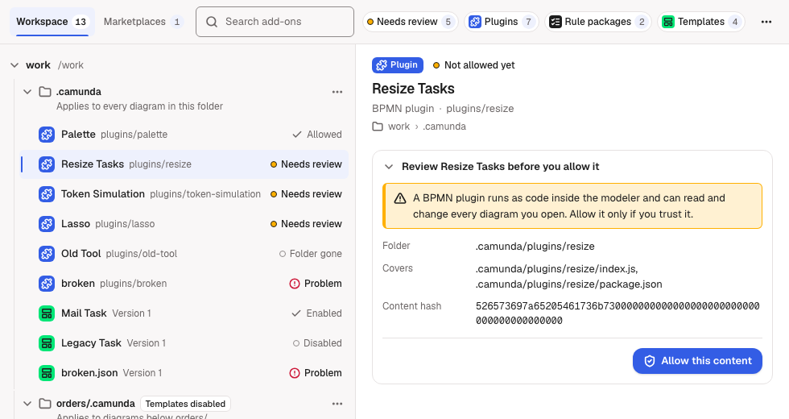
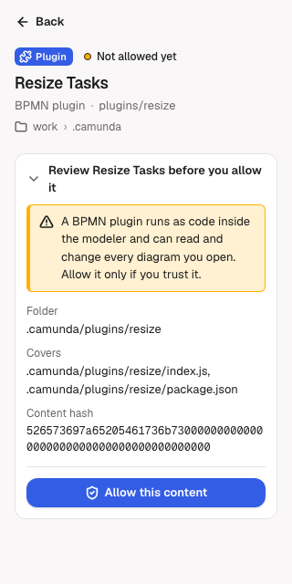

# Add-ons

See and manage everything your workspace adds to the BPMN editor in one place: [BPMN plugins](/vscode/features/bpmn-plugins), [bpmnlint rule packages](/vscode/features/linting#allow-a-rule-package), [element templates](/vscode/features/element-template-chooser) and [template marketplaces](/vscode/features/template-marketplace). Allow or revoke code, and turn templates on or off.

<figure class="shot"><figcaption>A wide view: the list on the left, the selected add-on's details on the right.</figcaption></figure>

## Open the view

Click the Miragon comet in the activity bar to open the **BPMN Modeler** container. **Add-ons** shows there whenever a folder is open; **Deploy** shows above it while a diagram is open. **Review…** on a plugin or rule package notification opens the view too (see [Allow code](#allow-code)). **Miragon BPMN Modeler: Review Add-ons** in the Command Palette opens it on the add-ons that need your review.

## What it lists

The view lists the open workspace only, never other projects. Two tabs at the top split it, each with its count:

- **Workspace**: your workspace folders, in the order they are open. Under each folder, one source per config folder (the root's `.camunda/`, and nested config folders whose diagrams you opened) and per package folder, then the add-ons of that source by name.
- **Marketplaces**: one source per registered marketplace, with its cached templates.

Click a folder or source to close or open it; a marketplace starts closed, as it can hold many templates. A closed one shows how many add-ons it holds, and an amber dot when one of them needs your review.

Each row shows the add-on's kind (an icon and the word for a screen reader), its name, and on the right one status:

- **Needs review** with an amber dot: the add-on waits for you to allow it.
- **Problem**: it cannot be read or used. The details say why.
- Otherwise its state, such as **Allowed**, **Folder gone**, **Enabled** or **Disabled**.

The details show each plugin's and rule package's full state:

| State | Meaning |
|---|---|
| Allowed | You allowed exactly this content, here or in another folder. It runs. |
| Not allowed yet | Never allowed. It does not run. |
| Changed, review needed | You allowed an earlier content; its files changed since. It does not run until you allow it again. |
| Declined this session | You left it unchecked in the list, or closed the list, this session. |
| Folder gone | You allowed it, but its folder no longer exists. |

## Search and filters

The search field narrows the list of the open tab to the add-ons whose name, path or version, kind, state, engine, source or folder contains every word you type. `Escape` in the field clears it.

The chips below it filter by kind (**Plugins**, **Rule packages**, **Templates**) and to **Needs review**. Each chip counts its add-ons in the open tab. Pick several kinds to see all of them; **Needs review** applies on top. While a search or filter is on, every folder and source with a match opens, so no match stays hidden; you can still close one, and it stays closed while you refine the search or change the chips. When you clear the search and the chips, the folders and sources show as you left them before. When nothing matches, **Clear filters** removes the search and the chips.

## Details

Click a row to see its details:

- the kind, the state, the name, then what it is, its path or version and its engine;
- where it lies: the folder and the source;
- a problem or a note, if the add-on has one;
- what you can do with it, as buttons: **Revoke**, **Forget**, **Review…**, **Disable** or **Enable**;
- for code you can allow, the review: what the code can do, its folder, version, the files it covers and its content hash, with **Allow this content** at its end.

When the view opens, it starts on the tab you chose last. Until you choose one, it starts on **Workspace**, or on **Marketplaces** when the workspace lists no add-on and a marketplace is registered. Each tab selects the first add-on that needs a review, else the first add-on, among the rows it shows, so a closed marketplace selects none of its templates until you open it. Your selection stays when you close its folder or source. When the view reloads, it keeps the tab you chose, the selection and the folders and sources you opened or closed; the search and the chips start empty.

**From 640 pixels wide** the list and the details stand side by side. **Narrower**, as the side bar usually is, the details open in place of the list; **Back** returns to the list where you left it. The view follows its width as you resize it.

<figure class="shot"><figcaption>A narrow view: the details in place of the list, with Back.</figcaption></figure>

## Allow code

Select a plugin or rule package that needs a review, check what its review says, then click **Allow this content**. The approval is for exactly this content: a later change shows it as *Changed, review needed*, and the code stops running until you allow it again. The same content in another folder, clone or git worktree shows as *Allowed* without asking, and the view records the approval for that folder too. Every open BPMN editor that offered an allowed plugin reloads with it.

**Review…** on a notification opens the view at the waiting plugins or rule packages when every one of them lies inside an open folder: it switches to the right tab, clears a search or filter that hides the first of them, selects it and opens its review. The notification then counts as answered for this window. Otherwise, for example when a rule package is linked from outside the workspace, **Review…** shows the list to check, as in [BPMN plugins](/vscode/features/bpmn-plugins#allow-a-plugin).

**Review Add-ons** in the Command Palette opens the view on the **Workspace** tab with only **Needs review** on, every folder and source with an add-on to review open. It clears the search and the kind chips, keeps your selection when it needs a review, else selects the first add-on that does, and moves focus to it. When the workspace lists add-ons but none needs a review, the list says *No add-ons need review.*; **Clear filters** shows everything again.

Before you allowed any rule package, one that no lint has asked about yet offers **Review…** in its details first. It reads the package; then its review offers **Allow this content**. Once you allowed one, the view reads every rule package at once.

## Revoke

**Revoke** takes your approval of this content back, in every folder where you allowed it; when other folders hold it, the details say how many before you click, and the result says how many it reached. A plugin stops at once: open editors reload without it. Its copy in VS Code's global storage is no longer loaded and is removed once it has gone unused for 30 days, or with **Remove unused plugin copies**. A rule package's rules are skipped from the next lint; code it already ran stays loaded until you reload the window. No notification in this window asks about it again, in any folder the view lists; allow it again here. Other windows ask again about their copies.

**Forget** removes only the approval of a folder that no longer exists. The content stays allowed in the other folders.

## Templates

Each template with an id offers **Disable** or **Enable** in its details. Each config folder or marketplace offers **Disable templates** or **Enable templates** for all of its templates in its **⋯** menu. A disabled template is left out of new choices in the [template chooser](/vscode/features/element-template-chooser) and the append menu; elements that already use it keep it. VS Code keeps the switches for you, outside the repository: a config folder's for this workspace, a marketplace's for all your projects once you registered it for all of them, else for this workspace.

## Marketplaces and plugin copies

The **Marketplaces** tab shows **Add marketplace…** and **Update marketplaces** above its list. With no marketplace registered, it says so and offers **Add marketplace…**; when the registrations cannot be read, it says why. Each marketplace's **⋯** menu offers **Remove**, which asks before it unregisters the marketplace. The [marketplace commands](/vscode/features/template-marketplace#add-a-marketplace) work as before.

**More actions** (**⋯**, next to the search field) holds **Add marketplace…**, **Update marketplaces** and **Remove unused plugin copies** in either tab. **Remove unused plugin copies** deletes every plugin copy in VS Code's global storage that no open editor of this window uses. Another window that still needs a copy writes it again the next time an editor there opens.

The result of an action shows at the top of the view; **Dismiss** closes it.

## Refresh

The view reads again when it is shown and whenever plugins, rule packages, templates, approvals or settings change. It does not watch `node_modules`: after an `npm install`, click **Refresh Add-ons** in the view's title bar.

## Appearance

The view wears the Miragon look, with its own colours, fonts and text sizes, in light, dark and high contrast. It follows whether your VS Code theme is light, dark or high contrast, not its colours. With `miragon.bpmnModeler.colorTheme` set to `light` it stays light, and keeps high contrast when your theme has it (see [Configuration](/vscode/configuration)). It does not follow the editor font size; VS Code's zoom scales it.

## Keyboard

`Tab` reaches every control: the tabs, the search field, the chips, **More actions**, the folders and sources, the rows and the buttons in the details. `Enter` or `Space` presses the focused control.

| Where | Key | What it does |
|---|---|---|
| Tabs | `←` / `→`, `Home` / `End` | Switch to the other tab |
| Search field | `Escape` | Clear the search |
| An open **⋯** menu | `↓` / `↑`, `Home` / `End` | Move through its items |
| An open **⋯** menu | `Escape` | Close it and return to its button |
| An open **⋯** menu | `Tab` / `Shift+Tab` | Close it and move on from its button |

## IntelliJ

The IntelliJ plugin shows the same page as the **Add-ons** tab of its **BPMN Modeler** tool window, for the open project; **Review…** opens it with the item selected, **Review Add-ons** (Tools ▸ Miragon BPMN Modeler, or Find Action) opens it on what needs your review, and **Refresh Add-ons** sits in the tool window's title. A tool window docked at the bottom is usually wide enough for the list and the details side by side. See [Getting started in IntelliJ](/intellij/getting-started#add-ons).

## Next steps

- [BPMN plugins](/vscode/features/bpmn-plugins): add plugins and what an allowed plugin can do.
- [Linting](/vscode/features/linting): rule packages and how they are checked.
- [Template marketplace](/vscode/features/template-marketplace): register marketplaces.
