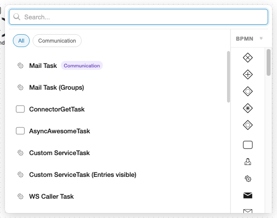
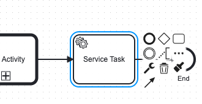
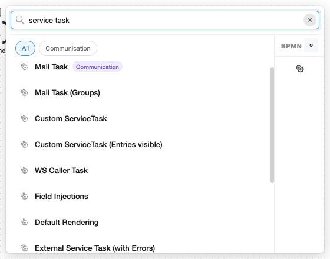
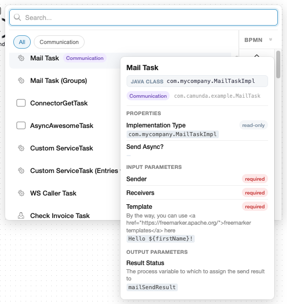
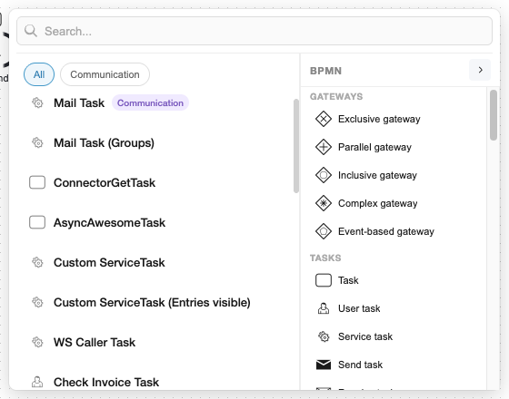

# Append menu

Append the next element from one panel that shows your element templates next to the plain BPMN elements.

<figure class="shot"><figcaption>Templates on the left, BPMN elements on the right, one search bar for both.</figcaption></figure>

## Open the menu

1. Select an element on the canvas, for example a service task.
2. Click **Append element** (the three-dot button) in the context pad, or press <kbd>A</kbd>.
3. Click a template to append a preconfigured element, or click a BPMN element to append a plain one.

<figure class="shot"><figcaption>The Append element button in the context pad.</figcaption></figure>

## What the panel shows

| Area | Use |
|---|---|
| Search bar | Filters both sides. Templates match on name, description, keywords, category and the BPMN types they apply to; elements match on label, description and keywords. |
| Category chips | One chip per template `category`. Click to filter, click again or **All** to reset. |
| Template list | Name, BPMN type icon, category badge and the template's own icon. Hover a card to see its implementation (Java class, delegate, topic, …), property count and documentation link. |
| BPMN palette | Standard elements grouped as gateways, tasks, sub-processes, events and data. Icons only by default; the chevron next to **BPMN** shows labels. On Camunda 7 and 8, hover an element, or move to it with the arrow keys, to see what it is for. |
| Favourites | Pinned elements at the top of the palette (see below). |

Searching for a type name such as "service task" also lists every template that applies to that type. On Camunda 8, element keywords work too: "child process" finds the call activity.

<figure class="shot"><figcaption>A search filters templates and BPMN elements together.</figcaption></figure>

<figure class="shot"><figcaption>Hover a template to see its implementation and property count.</figcaption></figure>

## Templates for several element types

A template that applies to one type is appended on click. A template that applies to several types (for example service task and call activity) is selected first: the palette then enables only the matching types, and you click the one to create.

## Favourites

Pin up to six elements at the top of the palette:

| Setting | Default |
|---|---|
| `miragon.bpmnModeler.favouriteBpmnElements` | `["bpmn:ServiceTask", "bpmn:UserTask", "bpmn:CallActivity", "bpmn:ExclusiveGateway"]` |

Favourites follow the same search and type filtering as the rest of the palette.

<figure class="shot"><figcaption>The palette with labels shown.</figcaption></figure>

## Keyboard

| Key | Action |
|---|---|
| <kbd>↓</kbd> / <kbd>↑</kbd> | Move through the template list or the BPMN palette |
| <kbd>←</kbd> / <kbd>→</kbd> | Switch between the template list and the BPMN palette |
| <kbd>Enter</kbd> | Apply the focused template or element |
| <kbd>Esc</kbd> | Close without applying (a click outside does the same) |

## Next steps

- [Flow navigation](/vscode/features/flow-navigation): walk the diagram with the keyboard, then append with <kbd>A</kbd>.
- [Element templates](/vscode/features/element-template-chooser): where templates come from and how to write them.
- [Template marketplace](/vscode/features/template-marketplace): share templates across projects.
