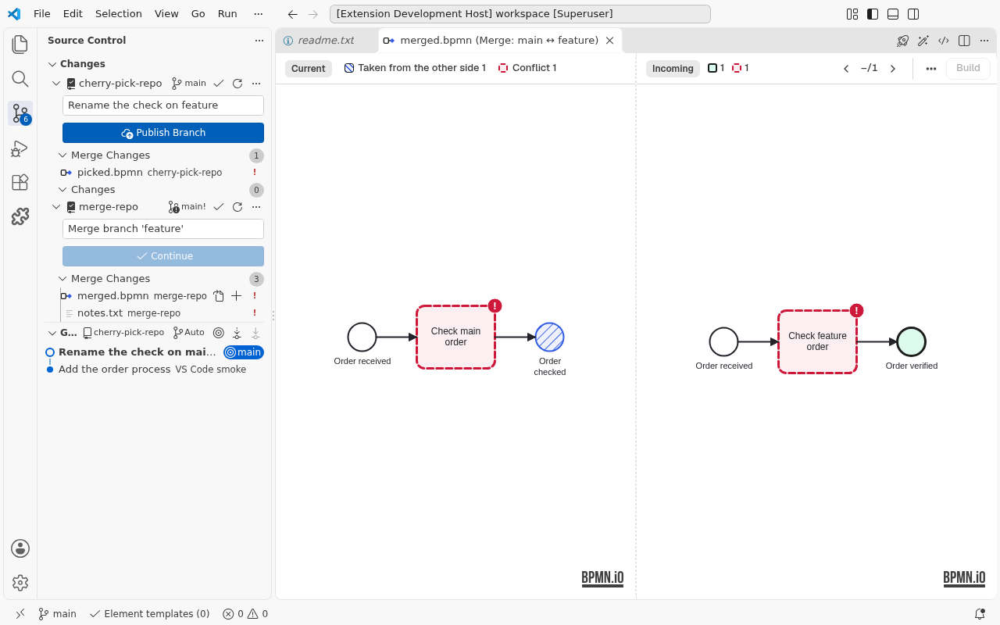
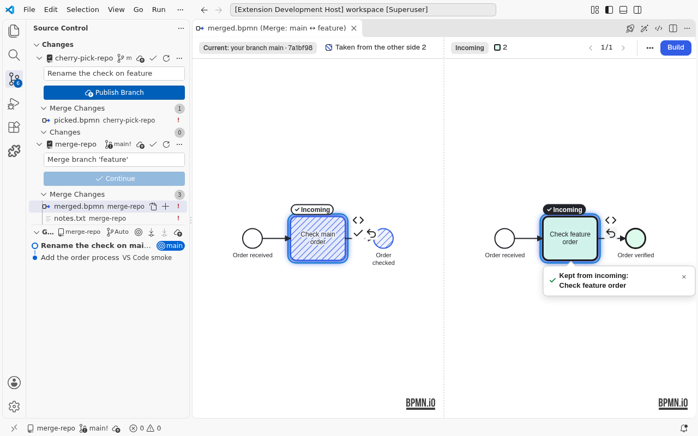
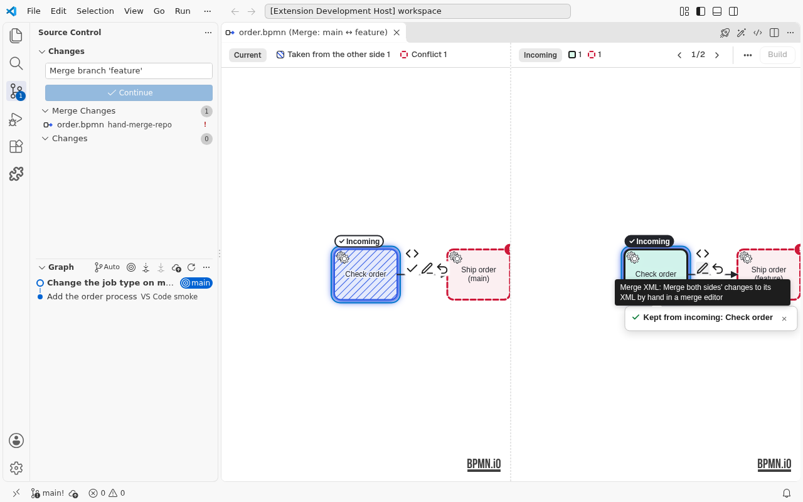
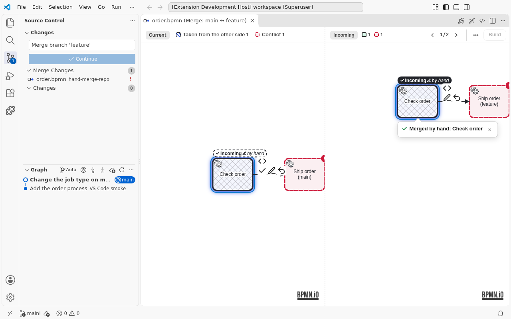
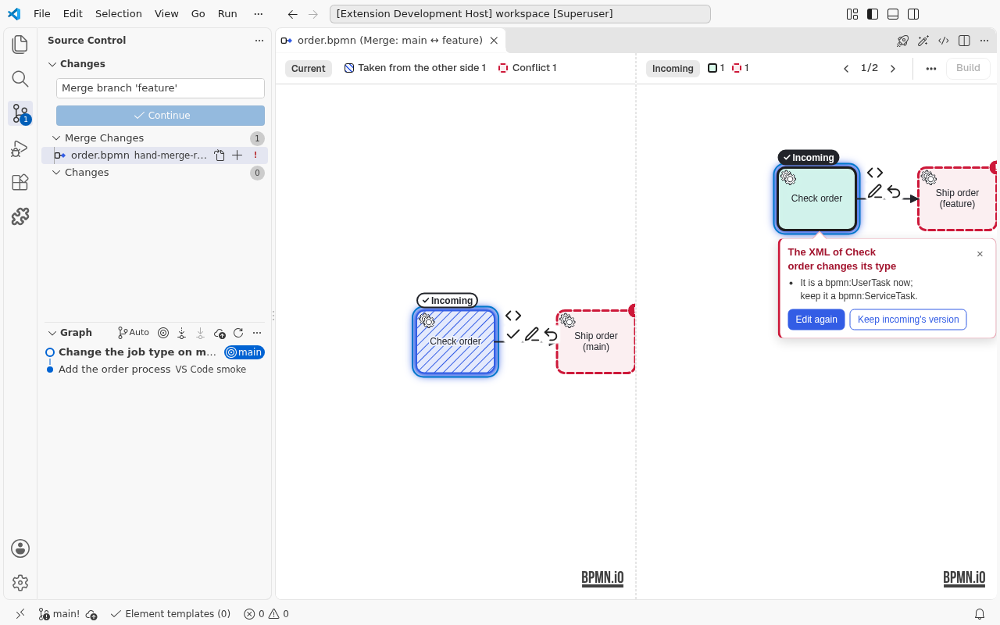
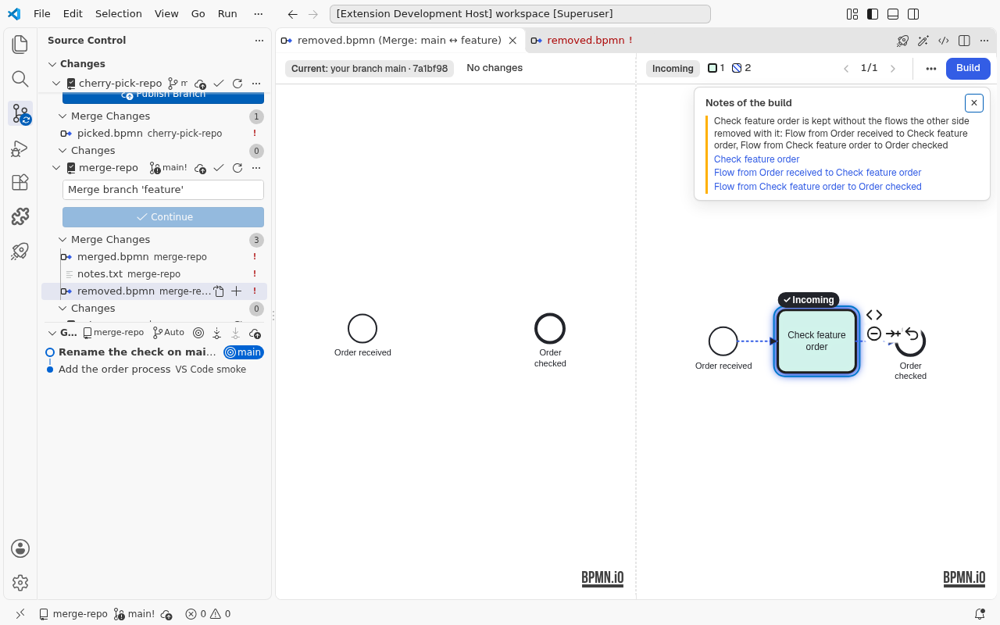
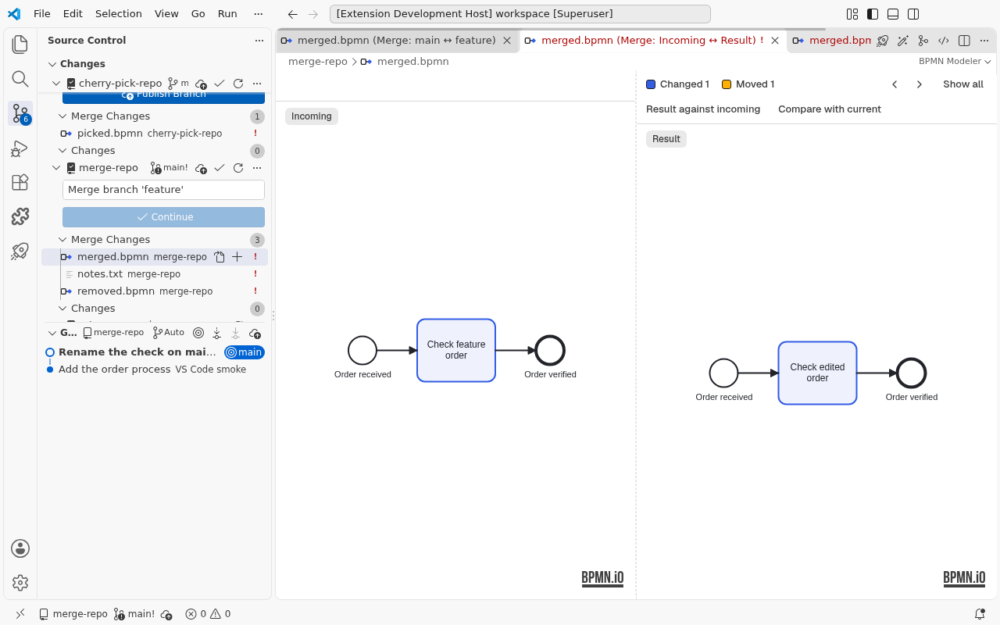

# BPMN merge

Resolve a Git conflict in a `.bpmn` file as two diagrams instead of conflict markers in XML. You decide per element which side to keep, build the result into the file, check it in the modeler and stage it as usual.

::: warning Alpha: check the result before you stage it
The BPMN merge view is in alpha. The file it builds can miss something one of the sides had, such as an element, an attribute, an extension element or a shape, in cases the merge view does not detect yet. Before you stage the file, look through it in the modeler and use [Compare the result](#compare-the-result) against both sides. Until you stage it, `git checkout -m -- <file>` brings back Git's conflict markers, so you can start over or resolve the file as text.
:::

<figure class="shot"><figcaption>Current on the left, incoming on the right, during a rebase too.</figcaption></figure>

## Open the merge view

After `git merge`, `git rebase`, `git cherry-pick` or `git stash pop` leaves a `.bpmn` file conflicted, open the merge view in one of these ways:

- In Source Control, right-click the file under **Merge Changes**, **Resolve in BPMN Merge View**.
- With the conflicted file active, **Resolve in BPMN Merge View** in the editor title or the Command Palette.
- Opening the conflicted file in the modeler shows a notice that it holds Git conflict markers; its **Resolve in BPMN Merge View** button opens the view.

The left pane always shows **current** (the side you are on), the right pane **incoming** (the side Git brings in). Each pane names what its side is to you: during a merge your branch and the other branch, during a rebase the other branch and your commit, after a stash pop your stash. Running the command again focuses the open view.

The entry shows on every row under **Merge Changes** while at least one BPMN conflict exists: VS Code cannot show a Source Control menu entry for some rows only. On a row it cannot open (a text file, a file one side deleted) the command says why.

Opening the view writes nothing: the file and Git's index stay as Git left them.

## Read the markers

<figure class="shot"><figcaption>One open conflict, and the end event the merge took from incoming without asking.</figcaption></figure>

| Marker | Meaning |
|---|---|
| **Conflict** (dashed contour, "!" badge) | Both sides changed the element differently, or one changed what the other removed. You decide. |
| **Taken from this side** (heavy contour) | The merge takes this pane's version without asking. |
| **Taken from the other side** (hatched) | The merge takes the other pane's version, also when the other side removed the element. |

Only content counts: a difference in layout is never a conflict. The merge keeps current's layout of an element unless only incoming changed it; an element inside a container can also take the side its container is drawn from, so it stays inside. When both sides moved an element to different places, the build notes it. Elements without a shape, such as the process's own attributes or a message, are listed in the right pane's **…** menu under **Not visible in the diagram**; the badge on **…** counts the open conflicts among them. Each row shows what the two sides hold: a line per attribute whose values differ, such as `errorCode: Current E1 · Incoming E2` (**none** where a side lacks the attribute), **Removed in current** or **Not in current** where a side lacks the element (removed from the common ancestor, or without one), and **and other content** where more differs, such as an extension or the parent. The row is titled with current's name, else incoming's, and a pick changes neither its title nor its value lines. The common ancestor's value is not shown. On every row, **</>** opens its XML changes; a side that lacks the element shows as empty.

Each pane has one bar: its side, branch and commit, and how many elements it marks with each marker. A pane counts only the elements its side has, so the two panes can count differently after the same picks; hover a count to read what it counts. On a narrow pane the bar drops the branch and commit first, then the counts' labels; narrower still, **Build** moves to the top of the **…** menu, so the bar stays one line down to VS Code's narrowest editor. The right bar also has **‹ n/N ›**, where N counts the open conflicts, those without a shape included. **‹** and **›** step through them in flow order on both panes; **All merged elements** in the **…** menu steps through every marked element instead, so you can also change what the merge decided by itself.

## Pick a side

<figure class="shot"><figcaption>A pick carries a badge naming the kept side above the element, on each pane that draws it.</figcaption></figure>

Step to an element with **‹** and **›**, or click it: the step selects it on each pane that draws it and opens its context pad there. While an element's XML changes are open, a step moves them to the element it lands on, as a click does; a step onto an element without a shape leaves them where they are. Hover an icon on the pad to see what it does:

- **Keep current** (left pane) or **Keep incoming** (right pane): keep that side's version.
- **Keep everything inside**: a sub-process, pool or lane with every element in it, from that side. A process, a collaboration or another container without a shape is kept with everything inside from its row in the **…** menu (see below); for a collaboration, everything inside is every pool and its process.
- **Leave out**: on an element only this side has, leave it out, as the other side removed it or never had it.
- **Also keep what was removed with it**: after keeping an element the other side removed, keep the flows and boundary events removed with it too.
- **Merge XML** (pen): on an element you picked whose versions in the common ancestor, current and incoming all differ, merge its XML by hand in VS Code's merge editor; **Edit merged XML** once you did. See [Merge an element's XML](#merge-an-element-s-xml).
- **Undo pick**: back to what the merge decided by itself.

An element without a shape is decided in its row of the **…** menu, which a step onto it opens: **Keep current**, **Keep incoming**, **Leave out** where one side lacks it, **Merge XML** where the pad would offer it, and **Undo pick** while your pick decides it. A container such as the process also shows the pad's **Keep everything inside** icon next to each side's **Keep**; it shows pressed while your pick keeps that side with everything inside. To decide by keyboard, see [Keyboard](#keyboard). A pick can pull in or drop other elements (a flow needs both of its ends). A card below the element, on the pane you decided on, says which side you kept or why the element was left out, and lists what the pick pulled in, dropped or opened again; a click on a name there shows that element. A refused pick names up to three reasons and marks the elements in the way. The card closes on the next step, when you select another element, or with **×**, and shows again when you select its element again, until the pane reloads. For an element without a shape its row says what the pick did. A pick a pane cannot draw is undone in the pad of the other pane, or in its row.

<figure class="shot"><figcaption>Keeping a task the other side removed offers the flows removed with it.</figcaption></figure>

Keeping an element the other side removed offers **Also keep the N flows … removed with it** on its card, and **Also keep what was removed with it** on its pad, or in its row for an element without a shape, whichever side you kept. The offer includes the boundary events the other side removed with a task, such as its timer, with the flows leaving them; the card then counts elements: **Also keep the N elements … removed with it**. A flow whose other end the other side removed too stays out, and so does a boundary event whose error, message or lane the other side removed too. Without the offer, the element is kept without them and the build notes what stays out: the boundary events removed with it and the flows of the element or of those events. A flow you keep that was the default flow of its gateway or task is its default again in the result, unless the other side made another flow the default; then that one stays and the build notes it.

## Merge an element's XML

When both sides changed one element in different places, for example current changed a service task's job type and incoming its input mapping, a pick keeps only one side's change. **Merge XML** opens the element's XML in VS Code's merge editor, so you keep both.

<figure class="shot"><figcaption>Merge XML shows on the pad once your pick decides the element.</figcaption></figure>

1. Pick the side the element starts from with **Keep current** or **Keep incoming**.
2. Click **Merge XML** on the pad, on its row in the **…** menu for an element without a shape, or press <kbd>Ctrl</kbd>+<kbd>K</kbd> <kbd>X</kbd>. The merge editor opens below the diagrams: current on the left, incoming on the right, the result below. VS Code takes the lines only one side changed by itself and leaves open only the lines both sides changed.
3. Resolve each open conflict in the result, then click **Accept Element XML Merge** (✓) in the editor's title. Saving with <kbd>Ctrl</kbd>+<kbd>S</kbd> and closing the tab does the same.

The merge view checks the text when the merge editor closes. If it takes the text, the badge on both panes reads **✓ Incoming ✎ by hand** (or Current), the card says **Merged by hand**, and the pad offers **Edit merged XML**, which opens the merge editor on the text you merged. Build writes that text for the element.

<figure class="shot"><figcaption>The badge names the side the text started from and that you merged it by hand.</figcaption></figure>

**What the text covers.** The element's own XML: its attributes, its documentation and its extension elements, such as a task definition, input and output mappings or listeners. What follows the pick stays out of it: the shape, the lane, the flows in and out, a flow's ends, a boundary event's task, a pool's process. A sub-process, pool or lane shows only its own attributes, documentation and extension elements; what lies inside it is decided element by element. Merge XML is offered only where the common ancestor, current and incoming all differ: an element both sides added, one whose type differs between the versions, or one where the ancestor equals a side has nothing to merge line by line.

**When the text is refused.** The element then keeps its version, and the card says why and what to change: the text still holds conflict markers, does not parse, holds more than one element, changes the element's type or ID, holds elements merged on their own (such as a task inside a sub-process), changes what follows the pick, names an element no version has or one the result leaves out, uses a namespace no version declares, is not taken by the engine's extension definitions, or would change the decision on another element. **Edit again** reopens the merge editor on the text you saved; **Keep incoming's version** (or current's, or the XML you merged before) closes the card.

<figure class="shot"><figcaption>A refusal names its reason; Edit again starts from the text you saved.</figcaption></figure>

Closing the merge editor without saving changes nothing; the card says so. A pick of the same side keeps the merged XML. A pick of the other side, **Undo pick**, or keeping a container from the other side with everything inside would drop it, so the card asks first: **This drops the XML you merged by hand for …**, with **Drop it and pick** (or **Drop it and undo**) and **Keep my XML**.

Two traps:

- **A save counts.** The text of your last save is taken when the merge editor closes, even if you then answer **Don't Save** to a later change. To leave without a change, close the tab without saving.
- **Complete with Conflicts** in VS Code's dialog keeps the common ancestor's lines for every conflict still open. That text parses and passes the checks, so the merge view takes it; only VS Code's dialog warns. Resolve every conflict before you accept.

## Build the result

<figure class="shot"><figcaption>Build waits until every conflict is decided.</figcaption></figure>

Once no conflict is open, **Build** in the right pane's bar (or in its **…** menu on a narrow pane) writes the merged diagram over the conflicted file, saves it and opens it in the modeler. The merge view stays open beside it, so you can change a pick and build again.

<figure class="shot"><figcaption>The built file is a normal file: edit, format and save it.</figcaption></figure>

- The file is the trial run: edit it in the modeler as usual. **Format Diagram** and **Clean Up Diagram** help with a layout put together from both sides.
- Nothing is staged. Git still lists the file as conflicted until you stage it.
- Build asks before it replaces your work: when the file has unsaved changes, when you changed it since the last build, when you changed Git's conflict markers since the merge view opened (for example, resolved a conflict by hand), or when it holds no conflict markers and was never built (you resolved it another way, or another merge tool changed it). Building over Git's markers as Git wrote them or over an untouched build does not ask.
- A failed build writes nothing. If the result fails a check, the file stays as it was and the message names the elements.

<figure class="shot"><figcaption>The notes name the elements to check; each name selects its element.</figcaption></figure>

**Review notes (N)** in the **…** menu lists what the build asks you to look at: a spot where the drawing broke as the two sides met, an element kept without the boundary events or flows removed with it, a kept flow that is no longer the default flow of its gateway or task, elements both sides moved to different places (one note per moved block, naming the side whose layout is kept), a part of the file's definitions (an attribute, its extensions or imports) that differs between the sides, of which current's is kept.

The build looks at the drawing it wrote and names each broken spot: a flow that does not meet the shape at one of its ends, two shapes on top of each other, a flow running through a shape that is not one of its ends, a shape outside its sub-process, pool or lane, a boundary event that is not on its task's border, and two lanes that overlap. It names only spots neither side drew: a flow one side already drew through a shape is that side's drawing, not a note. A flow that misses its shapes or runs through one is re-routed by the build, and its note says **The build moved … to meet …** or **… around …**, so you can check the new route; where no route fits, the note adds **the build could not repair it**. The build moves no shape; fix the other spots in the modeler before you stage the file.

## Compare the result

<figure class="shot"><figcaption>An edit of the result shows as a change against incoming.</figcaption></figure>

Once a result is built, **Compare with current** and **Compare with incoming** open the normal [BPMN diff](/vscode/features/bpmn-diff) of that side against a copy of the file as it is open, unsaved edits included. Against incoming, every element of incoming that is not in the result shows as removed, also one a pick dropped along with another; against current, you see what the merge brings in. While the merge view is open, the diff's bar switches to the other side. It shows the file as it was when the diff opened; open it again after an edit.

## Finish

Stage the file and continue as Git asks, for example:

```bash
git add order.bpmn
git merge --continue      # or: git rebase --continue, git cherry-pick --continue
```

To start over before you stage it, `git checkout -m -- order.bpmn` brings back Git's conflict markers.

## Keyboard

While a merge pane has the focus, these commands act on the element selected in that pane and do what the pad's icon for it does, side included. A command shows only where it applies, so a key that does nothing there keeps VS Code's own meaning.

Each is also in the Command Palette as **Miragon BPMN Modeler: Merge View: …**, and runs on the merge pane that had the focus last. The palette lists them once a merge pane got the focus, as when its tab opens or you click into it, and keeps listing them while the focus moves to the palette, the terminal or a side bar, as long as that pane's tab still shows in the active editor group. It stops when the tab is hidden or closed or another editor group becomes active. The keys act only while the pane itself has the focus.

| Key | macOS | Command |
|---|---|---|
| <kbd>Alt</kbd>+<kbd>F5</kbd> | <kbd>⌥</kbd><kbd>F5</kbd> | **Next Conflict**, as **›**, on the list chosen in **…** |
| <kbd>Shift</kbd>+<kbd>Alt</kbd>+<kbd>F5</kbd> | <kbd>⇧</kbd><kbd>⌥</kbd><kbd>F5</kbd> | **Previous Conflict**, as **‹** |
| <kbd>Ctrl</kbd>+<kbd>K</kbd> <kbd>K</kbd> | <kbd>⌘</kbd><kbd>K</kbd> <kbd>K</kbd> | **Keep This Side** |
| <kbd>Ctrl</kbd>+<kbd>K</kbd> <kbd>Shift</kbd>+<kbd>K</kbd> | <kbd>⌘</kbd><kbd>K</kbd> <kbd>⇧</kbd><kbd>K</kbd> | **Keep with Everything Inside** |
| <kbd>Ctrl</kbd>+<kbd>K</kbd> <kbd>L</kbd> | <kbd>⌘</kbd><kbd>K</kbd> <kbd>L</kbd> | **Leave Out** |
| <kbd>Ctrl</kbd>+<kbd>K</kbd> <kbd>Shift</kbd>+<kbd>F</kbd> | <kbd>⌘</kbd><kbd>K</kbd> <kbd>⇧</kbd><kbd>F</kbd> | **Also Keep What Was Removed With It** |
| <kbd>Ctrl</kbd>+<kbd>K</kbd> <kbd>X</kbd> | <kbd>⌘</kbd><kbd>K</kbd> <kbd>X</kbd> | **Merge XML**, also on an element merged by hand |
| <kbd>Ctrl</kbd>+<kbd>K</kbd> <kbd>Backspace</kbd> | <kbd>⌘</kbd><kbd>K</kbd> <kbd>⌫</kbd> | **Undo Pick** |
| <kbd>Ctrl</kbd>+<kbd>K</kbd> <kbd>B</kbd> | <kbd>⌘</kbd><kbd>K</kbd> <kbd>B</kbd> | **Build Result**; with conflicts open, a message says how many are left |

A step selects its element, so the keyboard way is <kbd>Alt</kbd>+<kbd>F5</kbd>, then <kbd>Ctrl</kbd>+<kbd>K</kbd> <kbd>K</kbd>. The commands leave the focus where it is; the card below the element says what the pick did. An element without a shape is decided with the buttons in its row of the **…** menu, which a step onto it opens. <kbd>Alt</kbd>+<kbd>F5</kbd> and <kbd>Shift</kbd>+<kbd>Alt</kbd>+<kbd>F5</kbd> are the keys VS Code's compare editor uses for the next and previous change; the <kbd>Ctrl</kbd>+<kbd>K</kbd> chords use second keys VS Code leaves free. Change any of them in **Keyboard Shortcuts** (search for `Merge View`).

## Limits

- The merge view is in alpha: check the built file before you stage it, as the note at the top says.
- Picks live while the merge view is open. Closing its tab or reloading the window loses them; a restored tab says the view has ended, and the command opens it again.
- VS Code only: IntelliJ opens no merge view. The standalone app is untested.
- Merge XML needs VS Code's merge editor: the standalone app and IntelliJ do not offer it. It also needs the element's version in the common ancestor.
- A merge by hand lives in the merge view like a pick: closing its tab or reloading the window loses it.
- For a `.bpmn` file under Git LFS or with a textconv driver, Git hands over text that is not BPMN, so the merge view refuses it.
- The Source Control entry shows on every Merge Changes row while a BPMN conflict exists, as explained above.

## Next steps

- [BPMN diff](/vscode/features/bpmn-diff): the same panes for any two versions.
- [Linting](/vscode/features/linting): check the built diagram before you stage it.
