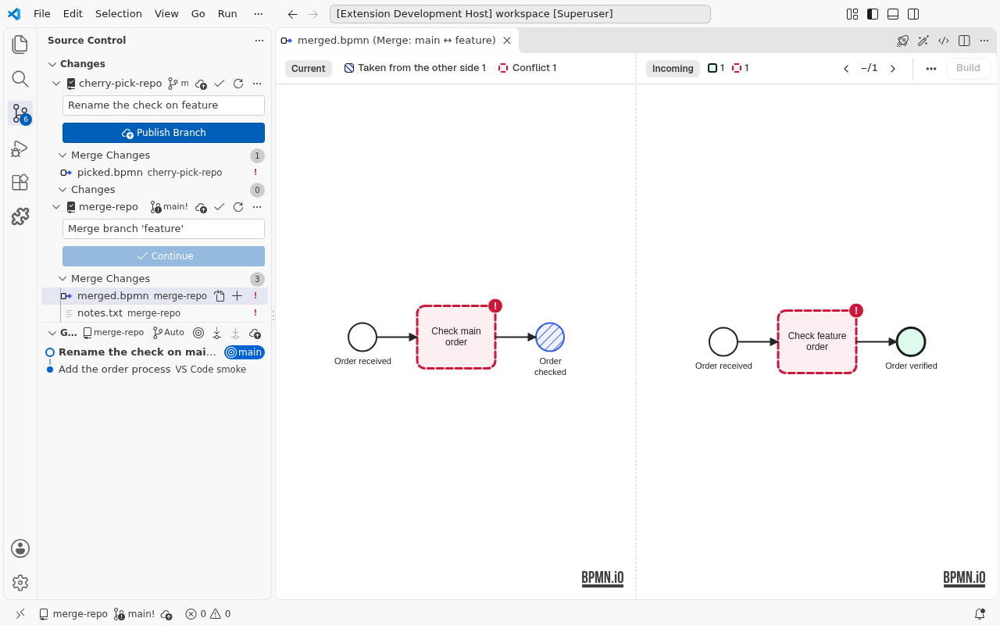
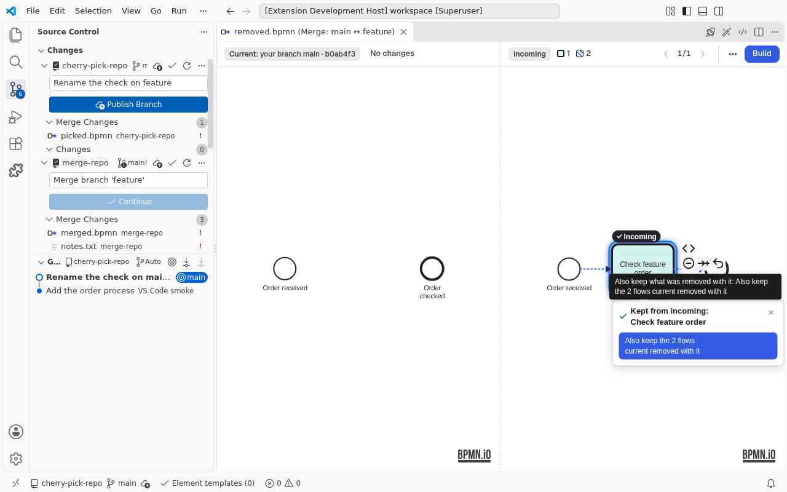
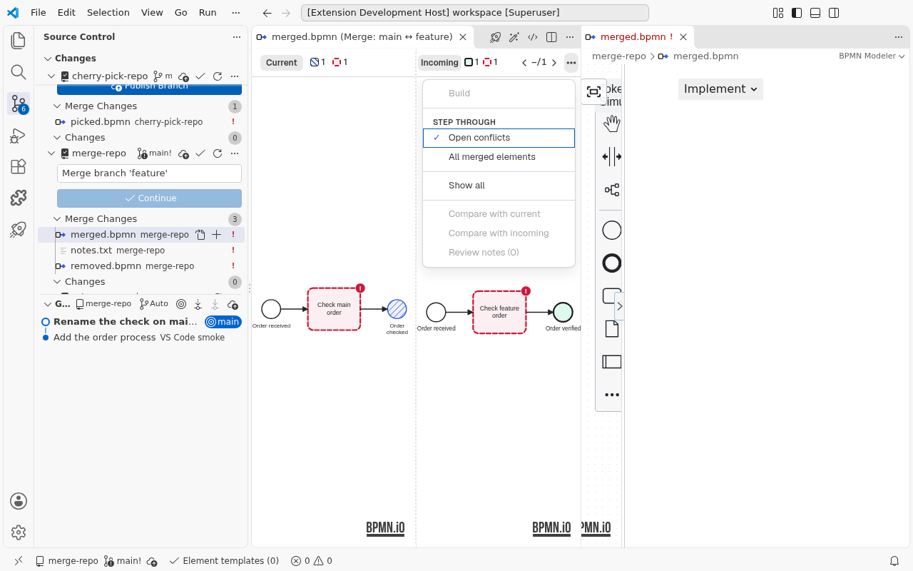
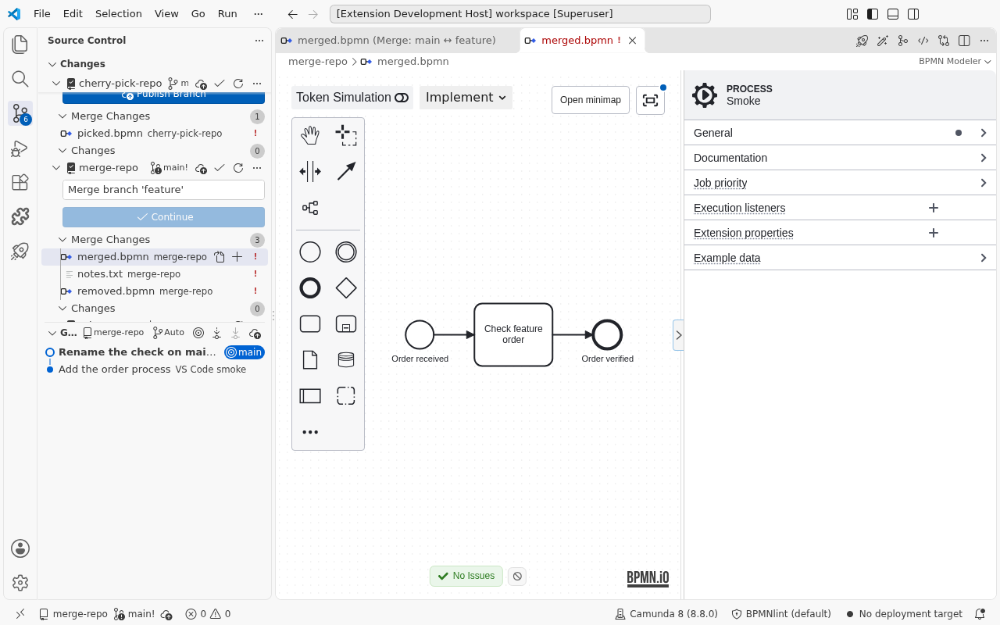

# BPMN merge

Resolve a Git conflict in a `.bpmn` file as two diagrams instead of conflict markers in XML. You decide per element which side to keep, build the result into the file, check it in the modeler and stage it as usual.

<figure class="shot"><figcaption>Current on the left, incoming on the right, during a rebase too.</figcaption></figure>

## Open the merge view

After `git merge`, `git rebase`, `git cherry-pick` or `git stash pop` leaves a `.bpmn` file conflicted, open the merge view in one of these ways:

- In Source Control, right-click the file under **Merge Changes**, **Resolve in BPMN Merge View**.
- With the conflicted file active, **Resolve in BPMN Merge View** in the editor title or the Command Palette.
- Opening the conflicted file in the modeler shows a notice that it holds Git conflict markers; its **Resolve in BPMN Merge View** button opens the view.

The left pane always shows **current** (the side you are on), the right pane **incoming** (the side Git brings in). Each pane names what its side is to you: during a merge your branch and the other branch, during a rebase the other branch and your commit, after a stash pop your stash. Running the command again focuses the open view.

The entry shows on every row under **Merge Changes** while at least one BPMN conflict exists: VS Code cannot show a Source Control menu entry for some rows only. On a row it cannot open (a text file, a file one side deleted) the command says why.

Opening the view writes nothing: the file and Git's index stay as Git left them.

## Read the markers

<figure class="shot"><figcaption>One open conflict, and the end event the merge took from incoming without asking.</figcaption></figure>

| Marker | Meaning |
|---|---|
| **Conflict** (dashed contour, "!" badge) | Both sides changed the element differently, or one changed what the other removed. You decide. |
| **Taken from this side** (heavy contour) | The merge takes this pane's version without asking. |
| **Taken from the other side** (hatched) | The merge takes the other pane's version, also when the other side removed the element. |

Only content counts: a difference in layout is never a conflict. The merge keeps current's layout of an element unless only incoming changed it; an element inside a container can also take the side its container is drawn from, so it stays inside. When both sides moved an element to different places, the build notes it. Elements without a shape, such as the process's own attributes or a message, are listed in the legend under **Without a shape**.

The legend counts the open conflicts. **‹** and **›** step through them in flow order on both panes; **Step through: All merged elements** steps through every marked element instead, so you can also change what the merge decided by itself.

## Pick a side

<figure class="shot"><figcaption>A pick carries a badge naming the kept side on each pane that draws the element.</figcaption></figure>

Select an element and use its context pad, or step to it and use the legend:

- **Keep current** (left pane) or **Keep incoming** (right pane), **Keep this version** on the pad: keep that side's version. On an element that side removed, this keeps the removal.
- **Keep everything inside**: a sub-process, pool or lane with every element in it.
- **Undo pick**: back to what the merge decided by itself.

Everything in the legend is a button, so the keyboard reaches all of it. A pick can pull in or drop other elements (a flow needs both of its ends); the legend says what the last pick did, and why a pick was refused, naming the element in the way. A pick the pane cannot draw is listed under **Your picks**, with its undo.

<figure class="shot"><figcaption>Keeping a task the other side removed offers the flows removed with it.</figcaption></figure>

Keeping an element the other side removed offers **Also keep the N flows … removed with it**. Without it, the element is kept without those flows and the build notes it.

## Build the result

<figure class="shot"><figcaption>Build waits until every conflict is decided.</figcaption></figure>

Once no conflict is open, **Build** in the right pane's legend writes the merged diagram over the conflicted file, saves it and opens it in the modeler. The merge view stays open beside it, so you can change a pick and build again.

<figure class="shot"><figcaption>The built file is a normal file: edit, format and save it.</figcaption></figure>

- The file is the trial run: edit it in the modeler as usual. **Format Diagram** and **Clean Up Diagram** help with a layout put together from both sides.
- Nothing is staged. Git still lists the file as conflicted until you stage it.
- Build asks before it replaces your work: when the file has unsaved changes, when you changed it since the last build, when you changed Git's conflict markers since the merge view opened (for example, resolved a conflict by hand), or when it holds no conflict markers and was never built (you resolved it another way, or another merge tool changed it). Building over Git's markers as Git wrote them or over an untouched build does not ask.
- A failed build writes nothing. If the result fails a check, the file stays as it was and the message names the elements.

<figure class="shot"><figcaption>The notes name the elements to check; each name selects its element.</figcaption></figure>

**Review notes (N)** lists what the build asks you to look at: a flow whose ends are drawn by different sides, two elements both sides added at the same place, an element drawn apart from its container, an element kept without the flows removed with it, elements both sides moved to different places (one note per moved block, naming the side whose layout is kept), a part of the file's definitions (an attribute, its extensions or imports) that differs between the sides, of which current's is kept.

## Compare the result

<figure class="shot"><figcaption>An edit of the result shows as a change against incoming.</figcaption></figure>

Once a result is built, **Compare with current** and **Compare with incoming** open the normal [BPMN diff](/vscode/features/bpmn-diff) of that side against a copy of the file as it is open, unsaved edits included. Against incoming, every element of incoming that is not in the result shows as removed, also one a pick dropped along with another; against current, you see what the merge brings in. While the merge view is open, the diff's bar switches to the other side. It shows the file as it was when the diff opened; open it again after an edit.

## Finish

Stage the file and continue as Git asks, for example:

```bash
git add order.bpmn
git merge --continue      # or: git rebase --continue, git cherry-pick --continue
```

To start over before you stage it, `git checkout -m -- order.bpmn` brings back Git's conflict markers.

## Limits

- Picks live while the merge view is open. Closing its tab or reloading the window loses them; a restored tab says the view has ended, and the command opens it again.
- VS Code only: IntelliJ opens no merge view. The standalone app is untested.
- For a `.bpmn` file under Git LFS or with a textconv driver, Git hands over text that is not BPMN, so the merge view refuses it.
- The Source Control entry shows on every Merge Changes row while a BPMN conflict exists, as explained above.

## Next steps

- [BPMN diff](/vscode/features/bpmn-diff): the same panes for any two versions.
- [Linting](/vscode/features/linting): check the built diagram before you stage it.
