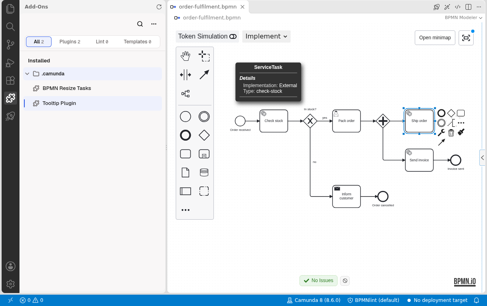
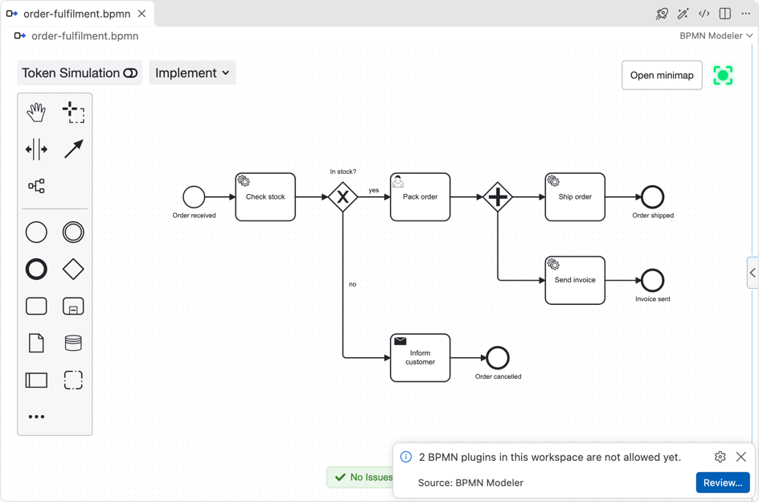
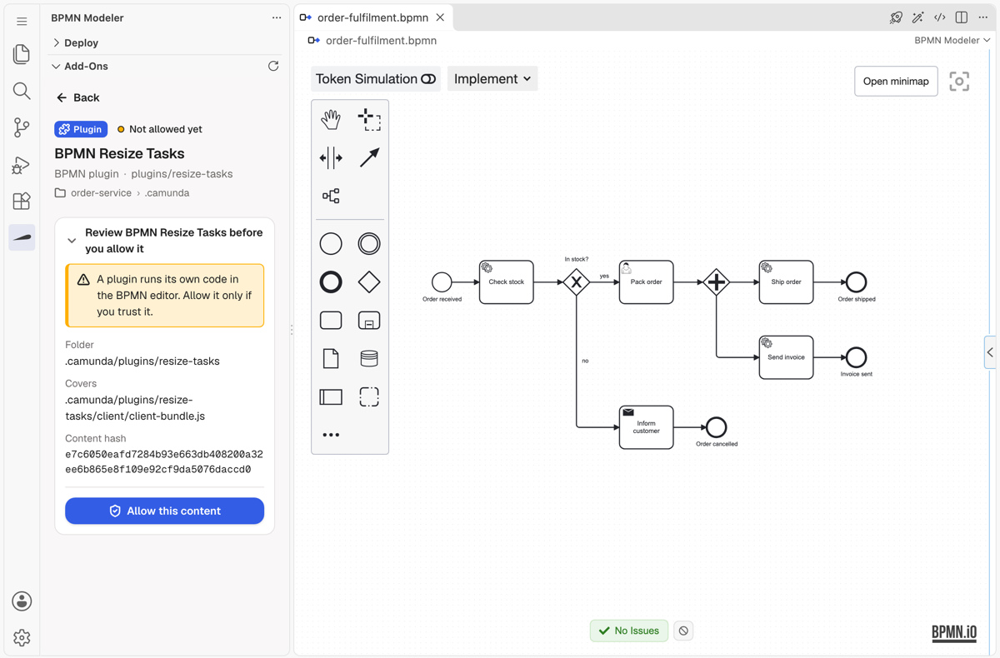

# BPMN plugins

Extend the BPMN editor with [bpmn-js](https://bpmn.io/toolkit/bpmn-js/) plugins that live in your repository, including many plugins written for the Camunda Modeler.

A plugin runs its own code inside the editor. The modeler loads it only after you allow it. It asks once per repository; later changes to the plugin run without a question.

::: info Alpha
BPMN plugins are in alpha. Not every Camunda Modeler plugin runs yet: see [the plugins we tested](#camunda-modeler-plugins-we-tested) and [Limits](#limits). Open work includes plugins for the DMN editor ([#2246](https://github.com/Miragon/bpmn-modeler/issues/2246)), style-only plugins ([#2266](https://github.com/Miragon/bpmn-modeler/issues/2266)), the lint rules Camunda plugins register ([#2267](https://github.com/Miragon/bpmn-modeler/issues/2267)) and a versioned host API for plugins ([#2316](https://github.com/Miragon/bpmn-modeler/issues/2316)).
:::

<figure class="shot"><figcaption>Two unmodified Camunda Modeler plugins after you allowed them: the tooltip from the viadee Tooltip Plugin and the resize handles from BPMN Resize Tasks.</figcaption></figure>

## Add a plugin

Put each plugin in its own folder under `<configFolder>/plugins/` (`.camunda/plugins/` by default). Like element templates, plugins are collected from the diagram's folder up to the workspace root:

```
my-project/
├── .camunda/plugins/
│   ├── example-plugin/           # a Camunda Modeler plugin, unchanged
│   │   ├── index.js
│   │   ├── dist/client.js
│   │   └── style/style.css
│   └── naming-hints/             # a plugin with its own manifest
│       ├── plugin.json
│       └── dist/plugin.js
└── processes/
    └── order.bpmn
```

The modeler learns from one file per folder which script to load. A `plugin.json` wins when both exist.

**`plugin.json`**

```json
{ "name": "Naming hints", "script": "dist/plugin.js", "style": "dist/plugin.css" }
```

| Field | Description |
|---|---|
| `script` | Required. The plugin's browser bundle. |
| `style` | Optional. A stylesheet loaded with the script. |
| `name` | Optional. Shown when you allow the plugin and in the log. The folder name if omitted. |

**`index.js` of a Camunda Modeler plugin**

```js
module.exports = {
    name: 'Example Plug-in',
    menu: './menu/menu.js',
    style: './style/style.css',
    script: './dist/client.js',
};
```

The modeler reads `name`, `script` and `style` from it as plain string literals and never runs the file. If the values are computed, for example with `path.join`, add a `plugin.json` next to it. `menu` and other entries are ignored.

Paths are relative to the plugin folder and must stay inside it. The script is the built bundle: build the plugin (for a Camunda plugin usually `npm run build`) and commit its output, because the modeler neither installs nor builds anything. A folder the modeler cannot read, for example without a manifest or with a missing script, is skipped and named in the *bpmn.modeler* output channel. The other plugins still load.

## What a plugin can register

A plugin script registers itself on `window.plugins`, the contract of [`camunda-modeler-plugin-helpers`](https://github.com/camunda/camunda-modeler-plugin-helpers). The [Camunda example plugin](https://github.com/camunda/camunda-modeler-plugin-example) is a good start for a new one.

| Registration type | Helper | Applies to |
|---|---|---|
| `bpmn.modeler.additionalModules` | `registerBpmnJSPlugin` | Every diagram |
| `bpmn.platform.modeler.additionalModules` | `registerPlatformBpmnJSPlugin` | Camunda 7 diagrams |
| `bpmn.cloud.modeler.additionalModules` | `registerCloudBpmnJSPlugin` | Camunda 8 diagrams |
| `bpmn.modeler.moddleExtension` | `registerBpmnJSModdleExtension` | Every diagram |
| `bpmn.platform.modeler.moddleExtension` | `registerPlatformBpmnJSModdleExtension` | Camunda 7 diagrams |
| `bpmn.cloud.modeler.moddleExtension` | `registerCloudBpmnJSModdleExtension` | Camunda 8 diagrams |

A diagram without an execution platform gets only the registrations for every diagram. A moddle extension needs a `prefix`. Any other registration type, such as `lintRules.*` and `dmn.*`, is skipped and named in the output channel.

A plugin built against the helpers' `vendor` modules, such as a properties panel extension or a `client` extension (the Camunda Modeler's React UI), needs globals that only the Camunda Modeler defines. Its script throws before it registers anything, so it is left out like a broken plugin.

Plugins load in the [Design and Implement modes](/vscode/features/modes), never in View, which has no modeling for them to extend. The [BPMN diff](/vscode/features/bpmn-diff) never loads plugins.

## Allow a plugin

When you open a diagram and its workspace holds plugins you have not allowed yet, the editor opens right away with the plugins you already allowed, and a notification says how many are waiting, for example *2 BPMN plugins in this workspace are not allowed yet.*

<figure class="shot"><figcaption>The editor opens right away; the notification counts the plugins that wait for you.</figcaption></figure>

1. Click **Review…**. The [Add-ons view](/vscode/features/add-ons) opens with the first waiting plugin selected and shows its folder and where an allowance would hold (**Allowed in**); the others carry **Needs review** in the list.
2. For each plugin you trust, select it and click **Allow** at the end of its review. Every open BPMN editor that offered it reloads with it.

<figure class="shot"><figcaption>Review… opens the Add-ons view on the first waiting plugin, with its folder and where an allowance would hold.</figcaption></figure>

**Review…** shows a list to check instead when a waiting plugin lies outside every open folder. Each entry shows the plugin's name and its folder. Check the plugins you trust and confirm.

Once **Review…** opened the view, the modeler does not ask again in this window about the same plugins; they wait in the view until you allow them. A plugin you leave unchecked in the list is not offered again until the window reloads. Closing the notification without **Review…** decides nothing: the modeler does not ask again in this window for the same plugins, and asks again in a later session. Only one question is open at a time, even when you open several diagrams. Questions about [bpmnlint rule packages](/vscode/features/linting#allow-a-rule-package) wait for the same turn.

An allowance is for the plugin at its place in your repository, not for its content:

- It covers the plugin in every worktree of its repository, later changes included: a `git pull`, an update or an edit runs without asking. Outside a git repository it covers the plugin's folder only.
- A second clone of the repository, another repository and a new plugin folder ask once.
- Allowances are kept for you in VS Code's global state, outside every workspace, so a repository cannot allow its own plugins. [Workspace Trust](https://code.visualstudio.com/docs/editor/workspace-trust) does not replace them: the extension does not run in Restricted Mode, and in a trusted workspace a plugin still needs its allowance. In a remote window (SSH, dev container, WSL) an allowance holds only for that remote.
- The editor loads a copy of the plugin's files from VS Code's global storage, made when the editor opens, never the files in your workspace. An edit reaches an editor the next time it opens, without asking.
- Approvals from earlier versions are rewritten as allowances when the extension starts. An earlier version of the extension does not read the new allowances and asks again.

## What an allowed plugin can do

::: warning Only allow plugins you trust
An allowed plugin has the same access as the BPMN editor itself. Whoever can change your repository, for example by a pull or an agent working in a worktree, changes what runs. **Revoke** a plugin before you check out code you do not trust.
:::

A plugin runs inside the editor's webview, not in the extension host, so it has no Node.js access. Within the editor it can do everything the editor can:

- It gets the modeler's injector, so it can change the diagram. Its changes are written to the file like your own edits.
- It can call every editor service, including the ones that reach VS Code: opening files and other models, the clipboard and the script editors.
- The editor may show images from any `https:` URL, which element template icons need. A plugin can therefore send data out through an image URL.

The allowance is the control. Neither the webview's sandbox nor its Content Security Policy keeps an allowed plugin from doing this.

## When a plugin breaks

- A script that cannot be loaded or throws while it runs is left out, and the other plugins still load. A notification says how many were left out, and the output channel says why.
- If the plugins keep the editor from being built, or the editor cannot load its plugin loader, the editor opens without any plugin and tells you so. A broken plugin never keeps a diagram from opening.

## Camunda Modeler plugins we tested

These unmodified plugins were run in November 2026, in VS Code and IntelliJ with the same result. Each was checked by using its feature, not just by loading it.

| Plugin | Extends | Result |
|---|---|---|
| [resize-tasks](https://github.com/philippfromme/camunda-modeler-plugin-resize-tasks) | Rules | Works. |
| [rename-technical-ids](https://github.com/camunda-community-hub/camunda-modeler-plugin-rename-technical-ids) | Commands, a panel | Works. Its menu shortcut does not exist here; use the buttons in its panel. |
| [tooltip plugin](https://github.com/viadee/camunda-modeler-tooltip-plugin) (viadee) | Overlays | Works. Its menu toggle does not exist here. |
| [moddle extension example](https://github.com/camunda/camunda-modeler-plugins) | Moddle extension | Works. |
| [task-listener](https://github.com/Hafflgav/camunda-modeler-task-listener-plugin) | Modeling | Works on Camunda 8 diagrams. On Camunda 7 diagrams, creating a user task breaks the diagram; the plugin does not check the engine. |
| [custom linter rules](https://github.com/camunda/camunda-modeler-custom-linter-rules-plugin) | Lint rules | Loads, but its rules do not run ([#2267](https://github.com/Miragon/bpmn-modeler/issues/2267)). |
| [style plugin example](https://github.com/camunda/camunda-modeler-plugins) | Style only | Skipped: a plugin needs a script ([#2266](https://github.com/Miragon/bpmn-modeler/issues/2266)). |
| [token simulation](https://www.npmjs.com/package/camunda-modeler-token-simulation-plugin) | Simulation | Breaks the simulation. The editor has [token simulation](/vscode/features/token-simulation) built in, so do not add this plugin ([#2268](https://github.com/Miragon/bpmn-modeler/issues/2268)). |
| [process-io-specification](https://github.com/camunda/camunda-modeler-process-io-specification-plugin) | Properties panel | Left out: needs the Camunda Modeler's properties panel API ([#2265](https://github.com/Miragon/bpmn-modeler/issues/2265)). |
| [script editor](https://github.com/knobik/camunda-modeler-script-editor-plugin) | Properties panel | Left out, for the same reason. |
| [reduced palette](https://github.com/camunda-community-hub/camunda-modeler-plugin-reduced-palette) | Palette, context pad | Loads, but empties the context pad: it was written for a far older bpmn-js. Do not use it. |
| [autosave](https://github.com/pinussilvestrus/camunda-modeler-autosave-plugin) | Camunda Modeler UI | Left out: it extends the Camunda Modeler's own window. |

In VS Code the output channel names the error of a left-out plugin only as *Script error.*; the IDE log in IntelliJ has the full message ([#2269](https://github.com/Miragon/bpmn-modeler/issues/2269)).

## Limits

- The editor shares none of its libraries with plugins. Plugins that bring their own copies and use only the services the editor injects work, even when they were built for an older bpmn-js. Properties panel extensions need the Camunda Modeler's shared properties panel and do not run.
- Camunda Modeler `client` extensions, menus and DMN plugins do not run. Plugins extend the BPMN editor only, not DMN or forms.
- An error a plugin throws after the editor opened, for example while you edit, is not contained: the editor may stop responding in parts until you reopen it, and the log does not name the plugin ([#2270](https://github.com/Miragon/bpmn-modeler/issues/2270)). Remove the plugin's folder if that happens.
- Plugins load when an editor opens. A change to a plugin's files reaches an editor the next time it opens, without asking.
- The [Add-ons view](/vscode/features/add-ons) lists and revokes allowances in VS Code, and the **Add-ons** tab of the **BPMN Modeler** tool window does in IntelliJ. **Revoke** takes the allowance back in every worktree of the plugin's repository. Copies of allowed plugins stay in VS Code's global storage. When the extension starts, it removes the copies no editor has opened for 30 days, such as the version before an update or a plugin you revoked.

## IntelliJ

The IntelliJ plugin loads BPMN plugins the same way: the same folders, the same notification with **Review…** and the same rules. These parts differ:

- **Review…** opens the **Add-ons** tab of the **BPMN Modeler** tool window with the plugin selected, where you allow it, and where **Revoke** takes an allowance back. When a plugin lies outside the project, or the tab cannot open, the list appears as in VS Code.

- The question is an IDE notification balloon. Closing the balloon with its X keeps it in the **Notifications** tool window, where **Review…** still works. Clearing it there decides nothing, like closing the notification in VS Code.
- Allowances are kept by the IDE for all your projects, outside every project, so a repository cannot allow its own plugins. A plugin you allow in one project window is allowed in the others too.
- Plugins load only in a project you trust in the IDE. In a project you did not trust, no plugin loads and nothing asks, though you allowed it in another worktree; trusting the project reloads the open editors with it. See [Project trust](/intellij/getting-started#project-trust).
- The editor loads a copy of the plugin's files from the IDE's system folder (`miragon-bpmn-modeler/bpmn-plugins`), never the files in your project. When a project starts its modeler process, the process removes the copies there that no editor has opened for 30 days.
- After you allow a plugin, every open BPMN editor that offered it loads anew. Your unsaved edits stay.
- An allowed plugin can do everything the editor can, as in VS Code, including sending its own messages to the IDE plugin. The allowance is the control here too.
- Messages that VS Code writes to the *bpmn.modeler* output channel, for example why a plugin was skipped, go to the IDE log (**Help ▸ Show Log in Finder**; **Explorer** on Windows, **Files** on Linux).

## Next steps

- [Editor modes](/vscode/features/modes): Design and Implement are the modes with plugins.
- [Element templates](/vscode/features/element-template-chooser): extend the editor with templates instead of code.
- [Configuration](/vscode/configuration): set the config folder name.
