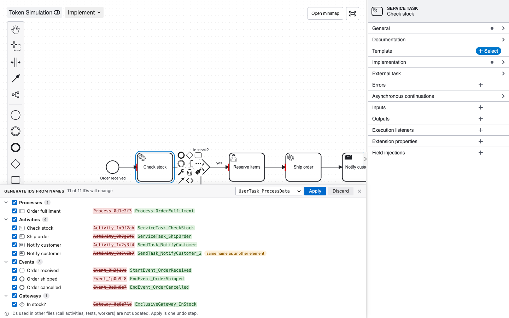
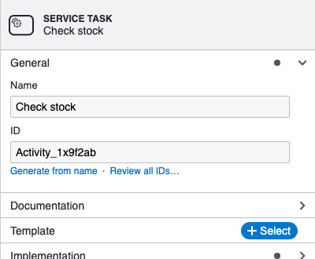

# IDs from names

Turn random IDs like `Activity_0x1y2z3` into IDs that read like the element's type and name, such as `ServiceTask_CheckStock`, for one element or the whole diagram.

<figure class="shot"><figcaption>The review lists every ID a name would change; one Apply renames them all.</figcaption></figure>

## Review every ID

1. Open a BPMN diagram in Design or Implement mode.
2. Run **Miragon BPMN Modeler: Generate IDs from Names** from the Command Palette, or pick it from the **…** menu in the editor title bar.
3. A panel opens along the bottom of the canvas. It lists every ID a name would change, grouped by kind, with the current ID struck through next to the new one. Click a row to select its element on the diagram.
4. Untick the IDs you want to keep, and click **Apply**.

**Apply** renames every ticked element as one change, so one undo puts all IDs back. **Discard**, the close button and <kbd>Esc</kbd> close the panel without changing anything. The panel follows edits you make while it is open.

| Part of the panel | What it shows |
|---|---|
| Summary | How many IDs will change. |
| ID style | The spelling for this run. It starts at `miragon.bpmnModeler.elementIds.style`. |
| Groups | Processes, pools, lanes, activities, events, gateways, flows and other elements. A group's checkbox ticks or unticks all its rows. |
| *same name as another element* | Two elements share a name and would get the same ID, so this one gets a counter, such as `SendTask_NotifyCustomer_2`. |
| Already match | Elements whose ID already follows their name, with or without a counter. They keep their ID. |
| No name, skipped | Elements without a name, or with a name that has no letter or digit to build an ID from. |

## One element

Select an element. Under its **ID** field in the properties panel, **Generate from name** renames this one ID, and **Review all IDs…** opens the panel for the whole diagram. The link is greyed out when the element has no name or its ID already follows the name.

<figure class="shot"><figcaption>The links under the ID field.</figcaption></figure>

## How IDs are spelled

| `miragon.bpmnModeler.elementIds.style` | *Process data* (user task) | *Payment received* (start event) | *10 days* (boundary timer event) |
|---|---|---|---|
| `typePrefix` (default) | `UserTask_ProcessData` | `StartEvent_PaymentReceived` | `BoundaryEvent_10Days` |
| `typeSuffix` | `ProcessDataTask` | `PaymentReceivedStartEvent` | `N10DaysBoundaryEvent` |
| `snakeCase` | `user_task_process_data` | `start_event_payment_received` | `boundary_event_10_days` |

- `typePrefix` and `snakeCase` start with the element's own type, such as `ServiceTask_`, `StartEvent_`, `ExclusiveGateway_`, `SequenceFlow_`, `Process_` or `Participant_`, so the ID says what the element is. After you turn a task into a service task, its ID `Task_CheckStock` no longer follows: the review and **Generate from name** offer `ServiceTask_CheckStock`.
- `typeSuffix` spells IDs the way the Camunda Modeler plugin [rename-technical-ids](https://github.com/camunda-community-hub/camunda-modeler-plugin-rename-technical-ids) does, so a model that plugin renamed already matches.
- `ä`, `ö`, `ü` become `ae`, `oe`, `ue`, and `ß` becomes `ss`; other accents are dropped (`Café` becomes `Cafe`). Punctuation separates words, apostrophes do not. A name in a script other than Latin has nothing to build an ID from and is skipped.
- A pool's process takes its own name, or the pool's name when it has none: the pool *Order handling* gives `Participant_OrderHandling` and `Process_OrderHandling`.
- An ID in the diagram interchange that follows the element's ID, such as `Activity_1x9f2ab_di`, follows the new ID too.

## IDs that follow names

With `miragon.bpmnModeler.elementIds.followName` on, an element's ID changes as you change its name, on the canvas or in the properties panel, or its type, while the ID is still random (`Activity_0x1y2z3`), a numbered placeholder (`Task_1`), or was generated from the old name and type. An ID you typed yourself never changes. One undo reverts the change and the ID together.

## Settings

| Setting | Default | What it does |
|---|---|---|
| `miragon.bpmnModeler.elementIds.style` | `typePrefix` | How generated IDs are spelled (see above). |
| `miragon.bpmnModeler.elementIds.followName` | `false` | Rename an ID along with its element's name and type, as described above. |

Both can be set per workspace, so a repository can share its ID convention in `.vscode/settings.json`.

## Limits

- IDs in other files are not updated: call activities that start this process, a Camunda 8 process ID (which deployments and process instances use), process tests such as `hasPassed("…")`, and job workers or listeners that name an element. Rename a process before its first deployment, or update those references yourself.
- View mode cannot change IDs. The command then asks you to switch to Design or Implement.
- An [inline script](/vscode/features/inline-scripting) editor that is open while its element is renamed keeps the old ID. Close it and open it again.

## IntelliJ

The same review opens from **Tools ▸ Miragon BPMN Modeler ▸ Generate IDs from Names**. The links under the ID field are the same. The two settings are under **Settings ▸ Tools ▸ Miragon BPMN Modeler** as **ID style** and **IDs follow names**, for all your projects.

## Next steps

- [Editor modes](/vscode/features/modes): Design and Implement can change IDs.
- [BPMN plugins](/vscode/features/bpmn-plugins): the Camunda Modeler plugin this feature replaces, and others that still run.
- [Configuration](/vscode/configuration): every modeler setting.
