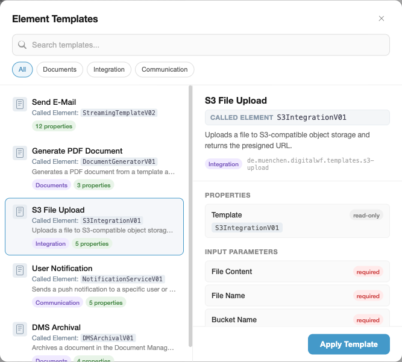
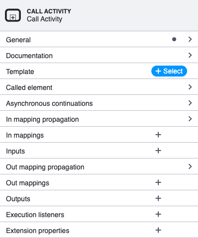
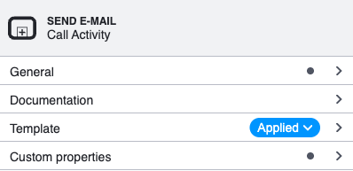
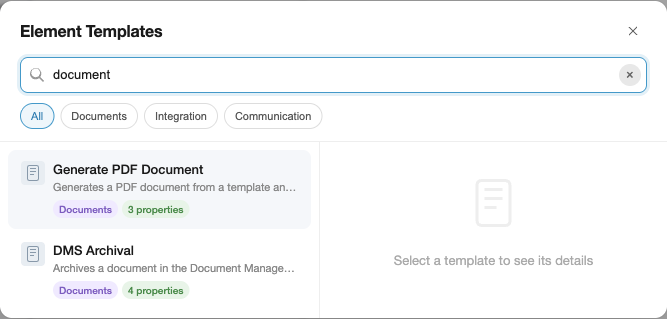

# Element templates

Browse, preview and apply [Camunda element templates](https://docs.camunda.io/docs/components/modeler/desktop-modeler/element-templates/about-templates/) from the properties panel, and keep your own templates next to your diagrams.

<figure class="shot"><figcaption>The chooser: matching templates on the left, a preview of the selected one on the right.</figcaption></figure>

## Apply a template

1. Select an element, for example a service task or call activity.
2. In the properties panel, open **Template** and click **+ Select**.
3. Pick a template to see its preview, then click **Apply Template** (or double-click the template).

The chooser lists only templates that fit the selected element. After applying, the properties panel shows the template name with an **Applied** badge.

<figure class="shot"><figcaption>Open the chooser from the Template section.</figcaption></figure>

<figure class="shot"><figcaption>An applied template and its custom properties.</figcaption></figure>

## Find a template

- **Search** matches name, description, category and `keywords` (case-insensitive).
- **Category chips** appear when templates have a `category`. Click one to filter, click it again or **All** to reset.
- Search and category combine; clearing one keeps the other.

Each card shows the template's implementation when it sets one of these bindings: `camunda:topic` (Topic), `camunda:delegateExpression` (Delegate), `camunda:class` (Java Class), `camunda:expression` (Expression) or `calledElement` (Called Element).

<figure class="shot"><figcaption>Search covers descriptions too: "document" also finds DMS Archival.</figcaption></figure>

### Keyboard

| Key | Action |
|---|---|
| <kbd>↓</kbd> / <kbd>↑</kbd> | Move through the list |
| <kbd>Enter</kbd> | Apply the selected template |
| <kbd>Esc</kbd> | Close without applying |

## Where templates live

Put template `.json` files in `<configFolder>/element-templates/` (`.camunda/element-templates/` by default). The modeler collects them from the diagram's folder up to the workspace root, so you can share templates project-wide or scope them to a folder:

```
my-project/
├── .camunda/element-templates/
│   └── send-email.json          # every diagram
└── processes/
    ├── .camunda/element-templates/
    │   └── special-task.json    # only diagrams in processes/
    └── my-process.bpmn
```

Open diagrams pick up added, changed and removed templates without a reopen, also when a whole config folder is moved in, moved out or deleted.

The config folder name is set by `miragon.bpmnModeler.configFolder`. To share templates across projects, use a [template marketplace](/vscode/features/template-marketplace).

Templates with an `engines` field (for example `"engines": { "camunda": "^8.7" }`) are shown only on Camunda 8 diagrams whose version matches. Templates without `engines` and all Camunda 7 diagrams are not filtered.

## Write good templates

A template needs `name`, `id`, `appliesTo` and `properties`. These fields make it easier to find and use:

| Field | Effect in the chooser |
|---|---|
| `description` | Shown under the name and in the preview. Say what the template does. |
| `category` | Adds a filter chip and a badge. |
| `keywords` | Searched, not shown. Add synonyms such as `["smtp", "notification"]`. |
| `documentationRef` | Adds a **Documentation** link to the preview. |
| `icon.contents` | Icon on the card (data URI). |

For properties:

- Always set `label`; without it the binding name is shown.
- Add `description` to fields that need explaining.
- `constraints.notEmpty: true` marks a field as required.
- `editable: false` marks a fixed value as read-only.
- Set a default `value` where a sensible one exists.
- Use `type: "Hidden"` for technical bindings; hidden properties are left out of the preview and the property count.

```json
{
    "$schema": "https://unpkg.com/@camunda/element-templates-json-schema/resources/schema.json",
    "name": "Send E-Mail",
    "id": "com.example.templates.send-email",
    "description": "Sends an email via the company SMTP gateway.",
    "appliesTo": ["bpmn:ServiceTask"],
    "category": { "id": "communication", "name": "Communication" },
    "keywords": ["smtp", "notification", "mail"],
    "properties": [
        {
            "type": "Hidden",
            "value": "${emailDelegate}",
            "binding": { "type": "property", "name": "camunda:delegateExpression" }
        },
        {
            "label": "Recipient",
            "description": "Email address or process variable (e.g. ${assignee})",
            "type": "String",
            "binding": { "type": "camunda:inputParameter", "name": "recipient" },
            "constraints": { "notEmpty": true }
        }
    ]
}
```

## Next steps

- [Template marketplace](/vscode/features/template-marketplace): share templates across projects.
- [Append menu](/vscode/features/append-menu): add a templated element as the next step.
- [Configuration](/vscode/configuration): change the config folder.
