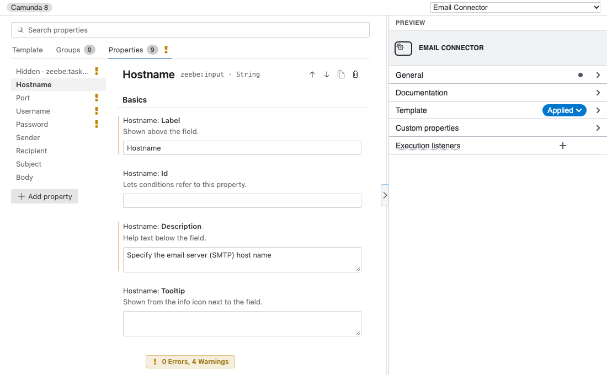
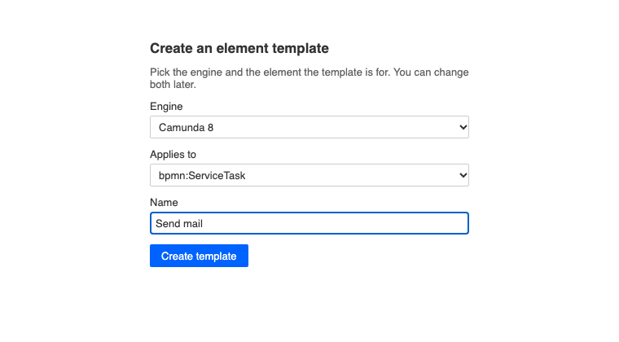
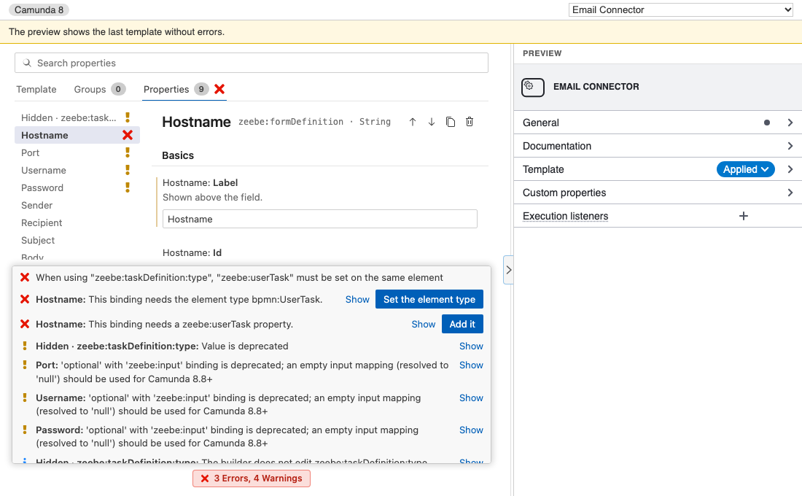

# Element template editor

Build [Camunda element templates](https://docs.camunda.io/docs/components/modeler/desktop-modeler/element-templates/about-templates/) for Camunda 7 and Camunda 8 in a form instead of writing JSON by hand, and see the properties panel the template produces while you work.

<figure class="shot"><figcaption>The editor: search and tabs at the top, the property list on the left, the selected property's settings in the middle and the preview on the right.</figcaption></figure>

## Create a template

1. Run **Miragon BPMN Modeler: New Element Template** from the Command Palette, or choose **File > New File… > Element Template**.
2. Enter a file name. The file goes into `<configFolder>/element-templates/` of your workspace folder (`.camunda/element-templates/` by default), where the modelers load templates from. In a workspace with several folders you pick the folder first; without an open folder you pick the file in a save dialog.
3. The editor opens with a short start form. Pick the engine and the element type the template is for, enter a name and click **Create template**.

<figure class="shot"><figcaption>The start form of a new, empty template file.</figcaption></figure>

The template is saved like any other file. Diagrams that load templates from that folder offer it in the [template chooser](/vscode/features/element-template-chooser) as soon as it is saved.

## Open a template

- A `.json` file in an `element-templates` folder opens in the template editor.
- A template elsewhere, a `.json` file whose `$schema` names an element template schema, opens as JSON. Click **Open in Element Template Editor** in its editor title, or use **Open With…**.
- `$schema` decides the engine: `…/element-templates-json-schema/…` for Camunda 7, `…/zeebe-element-templates-json-schema/…` for Camunda 8. A template without `$schema` asks for the engine and writes the matching `$schema`.
- A file with several templates gets a picker in the toolbar to choose which one to edit.

## Find your way around

The editor is laid out like VS Code's settings editor:

- **Template**, **Groups** and **Properties** tabs. Each tab shows how many items it lists and the worst problem in it.
- The **search box** narrows the current tab: properties by label, id or binding, groups by label or id, template settings by name or description.
- The **list on the left** shows the groups or properties; click one to edit its settings.
- Each **setting** is titled like *Hostname: **Label***, with a short description below. A bar marks the values the JSON sets.

The **preview** on the right shows the properties panel the template produces. Drag its divider to resize it, or click the arrow on the divider to hide and show it. A narrow editor, for example one next to the JSON, starts with the preview hidden.

## Edit the template

**Template** holds the name, id, version, description and documentation link, the element types the template applies to and, optionally, the element type it turns the element into when it is applied (with the event definition for events).

**Groups** put properties under their own heading in the properties panel. Add, rename and delete groups here; renaming a group's id moves its properties along. A property's **Group** setting moves it into a group.

**Properties** are the fields users fill in:

- **Add Property**, and the buttons next to a property's name to move it up or down, duplicate it or delete it.
- **Binding** decides where the value is written, for example an input mapping, a task header or a BPMN attribute. The binding's own fields follow, and switching the binding removes only what the new one does not allow.
- **Type** is the kind of field users see: String, Text, Boolean, Number, Dropdown or Hidden. A Dropdown gets its **Choices** here.
- **Value** is what new elements start with; for a Hidden property it is always written.
- Options such as **Editable**, **Required**, minimum and maximum length, a **Pattern** with its message and a **Placeholder**. On Camunda 8 also **FEEL**, **Optional**, **Tooltip**, the property's **Id** and **Show only when**: conditions on other properties (*Equals*, *Is one of*, *Is shown*, *Is empty*) that must all hold for the field to show.

Keys the editor does not have a field for stay as they are; a note under the property names them. A property with a binding the editor does not edit yet keeps its binding and can be edited in the JSON.

## Fix problems

The chip at the bottom of the form sums up the problems, for example **3 Errors, 4 Warnings**. Click it to list them above the form, errors first. **Show** opens the tab and the property a problem is about and focuses its field; some problems offer a fix in one click, such as adding the property a binding needs or setting the element type it needs.

<figure class="shot"><figcaption>A property switched to a form binding: two errors with their fixes, and the validator's deprecation warnings.</figcaption></figure>

The problems come from the official Camunda validator and from checks the schemas cannot make:

- property ids are unique;
- conditions and groups refer to properties and groups that exist;
- a Dropdown's value is one of its choices;
- a form is set by either a form id or an external reference;
- a binding has what it needs elsewhere, such as the element type or another property.

While the template has errors, the preview keeps showing the last template without errors and says so.

## The JSON

The JSON stays the source of truth. Click **Toggle JSON Editor** in the editor title to open it next to the template editor, with completion from its `$schema`; click it again in the template editor to close it.

- Every change in the form edits only the part of the file it concerns. Your formatting and keys the editor does not know stay as they are, and **Undo** takes back one change at a time.
- Changes in the JSON show up in the form right away.
- While the JSON is broken, the form shows the last valid template read-only and says what is wrong.
- Saving the file saves the changes of the form too.

## Limitations

- Templates for a process or a sequence flow cannot be previewed yet; they can still be edited.
- The template editor is available in VS Code and the desktop app, not in IntelliJ yet.

## Next steps

- [Element templates](/vscode/features/element-template-chooser): apply templates and decide where they live.
- [Template marketplace](/vscode/features/template-marketplace): share templates across projects.
- [Language support](/vscode/features/language-support): the editor follows the modeler's language.
